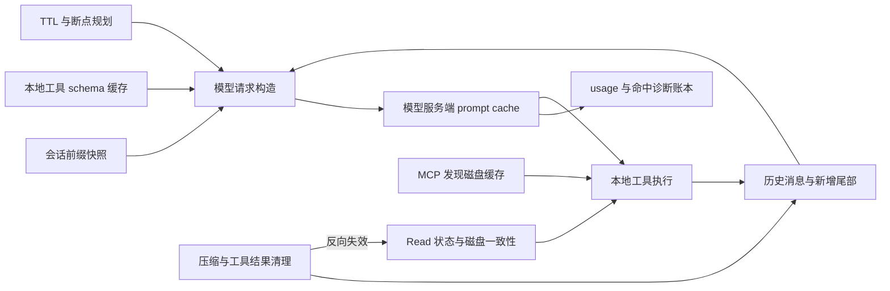

# Mac 上 Claude Code CLI 2.1.302 的缓存实现拆解

> 分析日期：2026-10-27（Asia/Tokyo）。分析对象是这台 Mac 实际执行的 Claude Code CLI 安装产物。本文不是 SuoCode 仓库实现说明，也不是从网络上的同名项目推测实现。

## 阅读导航

本文按“缓存什么 → 如何构造可复用输入 → 怎么命中 → 何时失效 → 怎样防止错误复用 → 怎样观察”的顺序拆解。

- [1. 最重要的结论](#1-最重要的结论)
- [2. 分析对象、证据等级与复核方法](#2-分析对象证据等级与复核方法)
- [3. Prompt caching 的协议基础：缓存的是输入前缀](#3-prompt-caching-的协议基础缓存的是输入前缀)
- [4. 模型请求：开关、TTL、前缀分区、断点与续租](#4-模型请求开关ttl前缀分区断点与续租)
- [5. 上下文与文件：Read 去重、写入一致性、压缩与工具清理](#5-上下文与文件read-去重写入一致性压缩与工具清理)
- [6. 本地缓存：通用原语、Git、MCP、网络、配置与凭证读取](#6-本地缓存通用原语gitmcp网络配置与凭证读取)
- [7. 运行观测：命中账本、变化指纹与失效归因](#7-运行观测命中账本变化指纹与失效归因)
- [8. 综合场景、迁移顺序与核验边界](#8-综合场景迁移顺序与核验边界)
- [9. 官方资料与代码证据的关系](#9-官方资料与代码证据的关系)

## 1. 最重要的结论

Claude Code 的核心优化，是把“连续请求中尽可能长的一段输入保持完全一致”变成整个 Agent 的架构约束。`cache_control` 是最后落到 API 上的标记；真正影响命中率的是标记之前的输入如何生成。

可以把整套策略分成四组：

| 层次 | 缓存对象 | 主要收益 | 一致性边界 |
| --- | --- | --- | --- |
| 模型服务端的 prompt cache | 模型已经处理的输入前缀 | 减少重复输入计算、等待时间和输入费用 | 模型、请求前缀、TTL、提供商支持及其他 API 条件 |
| 客户端的上下文管理 | 哪些文件、工具结果和消息仍在模型上下文中 | 不重复注入相同大段文本，控制上下文增长 | 文件版本、读取范围、消息是否已被压缩或移除 |
| 进程内的函数与状态缓存 | Promise、解析结果、配置、Git 状态等 | 减少文件系统、进程、网络和 CPU 开销 | 缓存 key、作用域、过期和主动失效 |
| 本地磁盘的持久缓存 | MCP 发现结果等可跨进程复用的数据 | 减少冷启动、schema 拉取和连接成本 | 账号与授权身份、协议、版本、TTL、写入竞争 |

这四层不能互相替代。文件读取缓存命中，不代表服务端 prompt cache 命中；删除磁盘缓存，也不能直接清空模型服务端的缓存。对话 transcript 是恢复材料，不能因此当成“Mac 本地保存的模型 KV cache”。



本文最值得移植的原则有五个：

1. **稳定前缀先行。** 工具、系统提示和项目上下文的生成顺序需要确定；动态信息优先追加到对话尾部。
2. **缓存对象有语义。** “读过文件”不等于“文件没变”，也不等于“模型现在还看得到这个文件”。命中条件必须同时检查。
3. **昂贵的辅助调用也复用前缀。** 摘要/压缩请求本身可能是最大的一次输入，不能忽略其缓存设计。
4. **异步失效必须防回填。** 清缓存之后，旧 Promise、旧账号请求或旧进程写入都不应让过时结果重新出现。
5. **测量和归因是实现的一部分。** CLI 自己维护命中账本、预期重建标记和前缀差异，不能只看一个 read token 数字。

这些是阅读下文代码后的工程归纳，不代表从客户端恢复出了服务端的 KV 管理、分布式淘汰或底层缓存 key 算法。

## 2. 分析对象、证据等级与复核方法

### 2.1 这台 Mac 上到底运行的是哪个 Claude

本次检查得到以下路径：

| 命令入口 | 安装位置/目标 | 本次观察 |
| --- | --- | --- |
| 当前 PATH 首选 `claude` | `/Users/hao/.nvm/versions/node/v24.14.1/bin/claude` | `--version` 输出 `2.1.302 (Claude Code)` |
| 当前入口实际目标 | `/Users/hao/.nvm/versions/node/v24.14.1/lib/node_modules/@anthropic-ai/claude-code/bin/claude.exe` | Mach-O 64-bit arm64 原生可执行文件 |
| 另一入口 | `/opt/homebrew/bin/claude` | 对应安装包 `2.1.289`，不作为本文代码基线 |
| 另一入口 | `/Users/hao/.local/bin/claude` | 另一个独立安装目录；不能把它的存在等同于当前执行版本 |

`bin/claude.exe` 在此 macOS 安装包里是原生 Mach-O 文件，`.exe` 后缀不表示它是 Windows 程序。包里的 `cli-wrapper.cjs` 是后备启动器；真正的缓存实现不在那段启动器代码里。

本次二进制的 SHA-256：

```text
5262ce9de86243fed0d21edc39b271555d56780d0112e2b194439fe1c6662d37
```

同版本号也可能有不同平台或重新构建的产物，因此复核时应同时对版本、平台和 hash。

### 2.2 能看到什么，不能看到什么

安装产物的 Bun `__bun` 段中保留了 `// @bun @bytecode` 开头的可读 JavaScript。本文从该二进制提取出 **2,451 段、47,004,277 字节**的可读打包源码，并全部匹配到了内部模块路径。

这里的“提取”是读取二进制内已有的源码字符串，不是执行它、把机器码反编译成 TypeScript，或者恢复 Anthropic 的原始 Git 仓库。打包符号大多经过缩短，没有原始注释、测试和完整类型信息。原始 TypeScript 文件名如果只出现在字符串里，也不能视为已恢复该文件。

本文采用以下证据口径：

| 标记 | 意义 | 能下的结论 |
| --- | --- | --- |
| **代码实证** | 当前 hash 的打包 JS 中存在具体逻辑，并追踪到相关调用/条件 | 该安装版本包含这些实现与分支 |
| **条件实现** | 实现受 feature flag、能力、认证类型、提供商或设置限制 | 条件满足时有该路径；不能断言此账号当前开启 |
| **官方协议** | 官方 API/CLI 文档对服务端行为的说明 | 补齐客户端无法自行证明的协议边界 |
| **分析推导** | 从代码结构推导动机、取舍或迁移建议 | 帮助设计；不是作者原话或生产遥测结论 |

本文没有发送付费模型请求，没有修改 Claude 的安装、配置或用户数据，也没有读取私人会话 transcript、认证文件或密钥。它是一份静态实现分析：没有测出这台机器实际账号的命中率，也没有验证远程 flag 在此账号的当前值。

尤其注意：打包中有一些同名功能的空实现。看到函数调用、遥测事件名或注释，不足以证明对应优化已经生效；需要看函数体和到达条件。

### 2.3 如何定位到具体代码

正文使用两种定位方式：

- **内部模块名**，例如 `chunk-hqtnbrjd.js`。它是二进制里 Bun 模块表中的真实模块名，不是本文猜的文件名。
- **模块起始字节 offset**，例如 `220845554`。它是该段 JS 在当前二进制里的绝对字节位置，十进制表示。提取后的文件名为 `000220845554.js`。

同一模块内的函数另有更精确的绝对字节 offset，见 [代码证据摘录](evidence/selected-symbols.md)。函数名只是这个版本里的缩短符号，升级后可能变化。

注意 JavaScript AST 的 `start/end` 使用 UTF-16 字符位置，不能直接加到二进制字节 offset 上。随附脚本使用 `Buffer.byteLength(source.slice(0, node.start), 'utf8')` 转换，再计算绝对位置。

### 2.4 随附文件和复核命令

| 文件 | 用途 |
| --- | --- |
| [tools/extract_embedded.py](tools/extract_embedded.py) | 只读解析 Mach-O/Bun、提取已有 JS、恢复内部模块名、记录 hash |
| [tools/inspect_symbols.cjs](tools/inspect_symbols.cjs) | 用 Babel 解析指定符号，输出格式化源码、绝对字节位置和源码 hash；不执行目标 JS |
| [evidence/source-index.json](evidence/source-index.json) | 本文重点模块的版本、路径、offset 与 hash 索引 |
| [evidence/selected-symbols.md](evidence/selected-symbols.md) | 重点小函数的完整代码和精确定位；大函数在正文分析关键分支 |

在本仓库根目录执行：

```bash
python3 docs/claude-code-cache/tools/extract_embedded.py \
  /Users/hao/.nvm/versions/node/v24.14.1/lib/node_modules/@anthropic-ai/claude-code/bin/claude.exe \
  /tmp/claude-code-2.1.302-review

node docs/claude-code-cache/tools/inspect_symbols.cjs \
  /tmp/claude-code-2.1.302-review/raw/000220845554.js \
  Lse A4 fSe
```

提取脚本仅用 Python 标准库。符号检查脚本使用本仓库已有的 `@babel/parser` 和 `@babel/generator`。它不下载工具，也不 `require`、`import` 或 `eval` Claude 的打包源码。约 47 MB 的完整提取物留在临时目录，不作为 README 的附带源码副本。

代码展示约定：标为“整理摘录”的代码只做排版和选段；标为“语义伪码/等价骨架”的代码使用解释性变量名、合并了外围逻辑，不应复制成可直接调用的原函数。

## 3. Prompt caching 的协议基础：缓存的是输入前缀

### 3.1 `cache_control` 的真实含义

服务端处理的前缀层次为 `tools → system → messages`。断点表示“缓存从开头到这里的全部前缀”，而不是单独缓存带标记的那个对象。API 限制断点数量，查找历史写入位置也有回看窗口；因此断点位置与历史写入位置都重要。参见 [官方 Prompt caching 协议](https://platform.claude.com/docs/en/build-with-claude/prompt-caching#explicit-cache-breakpoints)。

```text
服务端前缀顺序（示意）

[工具定义][静态系统提示][项目/会话上下文][历史消息][新消息]
                                       ↑旧断点          ↑新断点

下一轮若左边完全一致：
[可以复用的前缀........................][需要新处理的尾部]

若工具定义改变：
[变化][后面即使文本相同，也不再处在同一个完整前缀后面.....]
```

后文的系统分区、稳定工具排序、尾部提醒和压缩分叉，都是在维护这段前缀。客户端仍然会构造并发送上下文；缓存命中不等于“只发送新增文字”。

### 3.2 TTL 与计费不能混为一谈

协议提供默认 5 分钟与可请求的 1 小时 TTL；命中可以续期。更长 TTL 有不同的写入价格；读缓存仍是输入 token，也仍占上下文。模型间的缓存读取价格倍数有差异，不能一概写成“缓存永远便宜十倍”。本分析不把 API 单价直接等同于订阅额度的结算方式。[官方 TTL 与价格说明](https://platform.claude.com/docs/en/build-with-claude/prompt-caching#pricing)

真正要优化的是总成本：

```text
输入相关成本 = 未缓存输入 × 普通输入价格
             + 5m 写入 × 5m 写入价格
             + 1h 写入 × 1h 写入价格
             + 缓存读取 × 读取价格
```

这是一个分析公式，不包含输出、额外工具费用、订阅策略或其他价格修正。它解释了为什么“全部设 1h”和“每轮都标更多断点”不一定更划算。

### 3.3 CLI 的职责边界

CLI 决定请求结构、缓存标记、TTL 选择、前缀稳定性和观测；服务端决定实际缓存处理。CLI 中的 `Bun.hash`、SHA-256 或本地 Map key 都各有用途，不能称为已经恢复出的服务端 prompt cache key。

官方对 Claude Code 的说明也把 prompt cache 放在提供模型服务的一侧；本地文件编辑通常通过新消息进入上下文。[Claude Code 的缓存组织说明](https://code.claude.com/docs/en/prompt-caching#where-the-cache-lives)

## 4. 模型请求：开关、TTL、前缀分区、断点与续租

### 4.1 证据入口与调用链

- `/$bunfs/root/chunk-hqtnbrjd.js` = `raw/000220845554.js`，二进制嵌入起点 220845554。
- `/$bunfs/root/chunk-2bb0j573.js` = `raw/000216272108.js`，起点216272108。
- `/$bunfs/root/chunk-ck4jw7jw.js` = `raw/000216970082.js`，起点216970082。
- `/$bunfs/root/chunk-d81b6wth.js` = `raw/000216095555.js`。
- `/$bunfs/root/chunk-5c94ftfz.js` = `raw/000213953942.js`，beta 常量。

本章的“主 chunk”指 `chunk-hqtnbrjd.js`。注明“相对”的位置以对应模块起点为基准；可复核的精确绝对字节位置与原码 hash 见证据索引。

主链：

```text
HZ(...) / aIt(...)
  -> ARn(messages,systemPrompt,thinkingConfig,tools,signal,options)
     -> 生成/复用工具schema（A$）
     -> hRn 规范化消息
     -> yNs 加系统头/CLI身份前缀
     -> Lse 确定是否使用 prompt cache
     -> fSe / _tn 决定 TTL
     -> RYr -> YRo 构建 system 分区和 cache_control
     -> 每次 retry 构造 request 时重新计算 PA 开关
     -> TYr -> aTn 规划消息断点
             -> qVr/KVr 给 block 真正加 cache_control
     -> 请求 body {model,messages,system,tools,...}
     -> stream usage 汇总，fDs 做缓存破坏归因
```

`HZ` 是非流式调用包装：遍历 ARn 产出的 assistant，返回最后一个；没有 assistant 会抛错。缓存策略主体在 ARn，不在 CLI launcher。


### 4.2 开关：缓存默认开，允许按模型关闭，也允许单个请求覆盖

`Lse` 相对3371101：

```js
function Lse(e) {
  if (a.DISABLE_PROMPT_CACHING) return !1;
  if (a.DISABLE_PROMPT_CACHING_HAIKU && Ke(e,{identity:!0})===Ke(u1(),{identity:!0})) return !1;
  if (a.DISABLE_PROMPT_CACHING_HAIKU && lht()) {
    let n=VE();
    if(n!==et()&&e===n) return !1;
  }
  if(a.DISABLE_PROMPT_CACHING_SONNET){let n=Lm();if(e===n)return !1;}
  if(a.DISABLE_PROMPT_CACHING_OPUS){let n=Vg();if(e===n)return !1;}
  if(a.DISABLE_PROMPT_CACHING_FABLE){if(mle(e)||lke(e))return !1;}
  if(a.DISABLE_PROMPT_CACHING_MYTHOS){if(y$t(e))return !1;}
  return !0;
}
```

调用不是固定 Lse，而是 `Q.enablePromptCaching ?? Lse(model)`，请求显式参数优先。重试和 fallback 的 request builder 也会重新按实际模型计算 `PA`，没有把最初模型的启停状态不加检查沿用。`a` 是环境变量抽象，不应把这里描述为直接对 process.env 原始字符串做真假判断。

`A4` 相对3371578是统一 cache_control 工厂：

```js
function A4({scope:e,ttl:n}={}) {
  return {type:"ephemeral",...n&&{ttl:n},...e==="global"&&{scope:e}};
}
```

关键：代码里的 `cacheScope:"org"` 最终不会序列化 `scope:"org"`；工厂只显式发送 `scope:"global"`，普通 scope 省略并依赖后端默认。`ttl` 省略用于5m，显式1h才加 `ttl:"1h"`。


### 4.3 TTL 是多层策略，不是把所有东西写1h

`o5e` 相对2228922附近的源码：

```js
var o5e=["repl_main_thread*","sdk","auto_mode","memdir_relevance"];
function F7o(e){return u5e(e,o5e)}
function u5e(e,n){return e!==void 0&&n.some(r=>r.endsWith("*")?e.startsWith(r.slice(0,-1)):e===r)}
```

这不是“所有主代理/子代理”的笼统判断，是 querySource allowlist：以 repl_main_thread 开头、sdk、auto_mode、memdir_relevance 被分到主策略，其余用 subagent 级 env/settings。

`_tn` 相对2229195完整优先级：

```js
function _tn(e,n,r=!1) {
  if(a.FORCE_PROMPT_CACHING_5M)return {ttl:"5m",reason:"force_5m_env"};
  let s=F7o(e),h=s?a.CLAUDE_CODE_PROMPT_CACHE_TTL:a.CLAUDE_CODE_SUBAGENT_PROMPT_CACHE_TTL;
  if(h!==void 0)return {ttl:h,reason:"env"};
  let y=ut(),b=s?y.promptCacheTtl:y.subagentPromptCacheTtl;
  if(b!==void 0)return {ttl:b,reason:"setting"};
  if(n!==void 0&&!(n==="1h"&&r))return {ttl:n,reason:"agent_frontmatter"};
  if(a.ENABLE_PROMPT_CACHING_1H||Pe()==="bedrock"&&a.ENABLE_PROMPT_CACHING_1H_BEDROCK)
    return {ttl:"1h",reason:"enable_1h_env"};
}
```

`fSe` 相对3371676：

```js
function fSe(e,{agentCacheTtlOverride:n,ignoreOverage:r=!1,mainThreadModel:s}={}) {
  let h=kt(),y=h&&!r&&ha().isUsingOverage===!0,b=_tn(e,n,y);
  if(b!==void 0)return b;
  if(!h||y)return {ttl:"5m",reason:"default"};
  let w=V6o();
  if(w===null)w=k("tengu_prompt_cache_1h_config",{allowlist:[...o5e]}).allowlist??[],K6o(w);
  if(!u5e(e,w))return {ttl:"5m",reason:"default"};
  if(s!==void 0&&lGo(VU,s)&&k("tengu_tidy_frost",!1))
    return {ttl:"5m",reason:"live_5m_cache"};
  return {ttl:"1h",reason:"subscriber"};
}
```

`kt()` 是 OAuth scope 资格检测：`if(!wl()) return false; return lW(Nn()?.scopes)`，不要笼统翻译成任意“付费用户”。代码自己把最终 reason 命名 subscriber。

优先级表：

|顺位|条件|结果|
|---|---|---|
|1|FORCE_PROMPT_CACHING_5M|5m|
|2|按 querySource 选主/子 TTL 环境变量|显式TTL|
|3|按同类选 promptCacheTtl/subagentPromptCacheTtl settings|显式TTL|
|4|agent frontmatter override|显式TTL，但 overage 时1h override被跳过|
|5|ENABLE_PROMPT_CACHING_1H，或bedrock专用env|1h|
|6|没有 OAuth scope 资格或当前overage|5m|
|7|订阅 allowlist querySource匹配|候选1h|
|8|已有活跃5m请求且 tidy_frost flag开|继续5m，避免升级破坏现有缓存|
|9|其余allowlist订阅请求|1h|

overage 并不是绝对强制5m：_tn 的 env/settings/enable1h 能先行返回；被明确限制的是某些默认逻辑与 frontmatter1h。

#### 4.3.1 system 与 messages TTL 可分开

```js
function aQ(e){return a.CLAUDE_CODE_MESSAGES_PROMPT_CACHE_TTL==="5m"?"5m":e}
```

ARn：

```js
cR = fSe(Q.querySource,{agentCacheTtlOverride:Q.agentCacheTtlOverride,mainThreadModel:fi||Coe?Gt:void 0});
mR = cR.ttl==="1h"?"1h":void 0; // system
 gT = SYr(cR.ttl)==="1h"?"1h":void 0; // messages
 UB = gT!==mR;
```

因此可以稳定 system1h，增长快的 messages5m。`UB` 混合 TTL 时不把 cR 交给 keepalive，这是缓存策略联动。


### 4.4 System prompt 分静态和动态，尽量在后面承受变化

`YRo` 在 chunk-2bb0j573 相对180279；`RYr` 在主chunk相对3517329。

`__SYSTEM_PROMPT_DYNAMIC_BOUNDARY__` 是内部分界标记 `tO`。它只参与分组，不上 wire。主要路径：

1. 提取 `x-anthropic-billing-header:` 开头的计费头。
2. 提取已知 CLI身份句（普通CLI、SDKCLI、SDKagent）。
3. 提取 reporting-outcomes 固定块。
4. 其余内容按 boundary 前后分组，前面静态 join(`\n\n`)标 global，后面动态 join(`\n\n`)标 org。
5. identity、billing 等特殊块在 global 分区模式中 cacheScope=null，避免在它们上另插断点，但它们仍位于整个 prefix 之中。

核心代码：

```js
let Y=R.join("\n\n");
if(Y)H.push({text:Y,cacheScope:"global"});
let K=I.join("\n\n");
if(K)H.push({text:K,cacheScope:"org"});
```

`RYr`：

```js
function RYr(e,n,r){return YRo(e,{skipGlobalCacheForSystemPrompt:r?.skipGlobalCacheForSystemPrompt})
  .map(s=>({type:"text",text:s.text,...n&&s.cacheScope!==null&&{
    cache_control:A4({scope:s.cacheScope,ttl:r?.cacheTtl})
  }}));}
```

#### 4.4.1 Global scope 不是所有安装环境普遍生效

`g7`（chunk-2jyw98bz，相对388354）：

```js
function g7(){if(!gy())return !1;if(!Pi())return !1;let e=Pe();return e==="firstParty"||e==="anthropicAws"}
```

`gy` 是实验beta可用能力；`Pi()` 大体检查 first-party base URL（含 assume override）；`Pe()`是provider。

ARn 会结合 inline MCP 工具计算 `Co = br && Po.some(tool=>tool.isMcp===true&&!Fr(tool))`（说明性变量名），调整 `globalCacheStrategy` 标签并传入 `skipGlobalCacheForSystemPrompt:Co`。但 `YRo` 只在**没有 boundary marker** 时使用这个 skip 参数进入普通 scope 回退；有 boundary 时仍可构造 global 静态段。因此，策略标签 `none` 本身不能证明最终 wire request 没有 global 标记，必须检查 `RYr` 的实际输出。也不能据此声称 MCP schema 一定进入 global cache。

#### 4.4.2 无 boundary 或 gates未满足的回退

billing头无自身断点，CLI身份块 ordinary scope，剩余system合并一个ordinary scope。源码会发 telemetry，区分 boundary_found、missing_boundary_marker、using_tool_based_cache。重排动态块/改写长静态前缀仍会影响缓存，单纯加 marker无法修复不稳定序列。


### 4.5 消息断点规划：尾部 + 分叉/父前缀，且必须是可标记block

`aTn` 主chunk相对3273599；`TYr`相对3515067。局部函数 `Se` 是“向前找上一条有资格承接断点的逻辑消息”。

```js
let _e=jt=>iTn(jt,b),
 ke=jt=>jt.type==="api_system"||jt.type==="user"&&jt.ephemeral===true||!_e(jt),
 Se=jt=>{let Ht=jt;while(Ht>=0&&ke(e[Ht]))Ht--;return Ht;},
 be=Se(e.length-1);
if(skipCacheWrite)be=Se(be-1);
```

跳过 api_system 是基础后退逻辑；随后另行检查尾部 api_system 能否单独标记：它不能 ephemeral、不能为空、不能夹着 request-scoped ephemeral user。能力允许且缓存开、不是skipCacheWrite，尾部api_system可替代基础末消息成为断点。

这个选择保护“真正会在下一次继续出现的输入前缀”。`skipCacheWrite` 语义不是完全不发送任何cache_control：它先从最后资格消息后退一条，仍可读/标既有较早前缀；请勿把名称翻成彻底禁用cache。

assistant block资格 `ctt` 相对3272915：

```js
function ctt(e,n) {
 if(e.type==="text"){
   if(typeof e.text!=="string"||e.text==="")return false;
   return !n||e.text.trim()!=="";
 }
 return e.type!=="thinking"&&e.type!=="redacted_thinking"&&!fV(e);
}
```

`fV` 是另一类内部block资格检查，未追全，不要宣称“所有其他类型都可标”。

#### 4.5.1 分叉前缀固定

`aTn` 先计算 divergence/parentReply前面的资格位置，若比尾部断点早，则把这个位置也加入 Set，保护父请求已缓存前缀。

另一个 forkCachePin 路径（`iIt()=gy()&&k("tengu_basalt_spur",false)`）支持 forkPointUuid：定位该uuid、若不能直接标记则找前一条可标消息；未显式给forkPoint且没有skipCacheWrite，则标尾前一条。`tengu_basalt_scarp` 控制 skipCacheWrite forkpoint处再退步。此路径 feature flag 默认false，不能说所有分叉请求必然双断点。

上面 `skipCacheWrite` 是说明性名称，原函数相应参数为 `r`。如果 request 有 top-level cache_control，则不再另加 parent/fork位置。这是协调有限 marker资源，避免多个方案叠加失控。

#### 4.5.2 写到 content block 上，而不是 message对象

`qVr`（3374186）：user字符串先转为 `[{type:"text",text:...}]`；数组先去掉空白text（uRn），然后在最后block追加cache_control。

`KVr`（3374911）：assistant字符串同理；数组只在“最后block可标”时加，避开thinking/redacted等。

```js
return {role:"assistant",content:e.message.content.map((block,index)=>({
 ...block,
 ...index===e.message.content.length-1&&ctt(block,whitespaceGate)
   ? cachingOn?{cache_control:A4({ttl})}:{} : {}
}))};
```

上段用描述性变量改名，等价于KVr源码，非原始符号文本。

api_system 可含 tool additions/removals，TYr会把 marker传给Iks，放在最后的工具增量block；ephemeralSuffix则单独追加在断点后，避免一次性后缀进缓存边界。

TYr还调用MEn/OEn映射逻辑消息到 wire消息，维护wireIndexOf（包括折叠/移除carrier的情况）。这是为什么不能直接按 UI 消息列表索引猜测真实cache断点。


### 4.6 Keepalive：用轻量触碰续租，带资格、确认、退避和退出

以下涉及定时器、SDK 请求的短代码为裁剪/局部重命名的实现示意，精确函数可查原代码证据。整个子系统在主chunk相对225678至239621，功能flag `tengu_sequential_cloud`，schema必须 `{enabled:true,...}` 才通过，读取远程 flag 时的本地 fallback 为 false。并非已证明在用户当前账户开启。

#### 4.6.1 配置与门槛

```js
var Sno="anthropic-cache-keepalive", bno="/v1/messages/cache_touch", vNe=10000,
 wno=3, vno=3, Tno=3, q3=VU, rwt=q3-vNe, Eno=3600000, Rno=240000;
// schema:
// touchIntervalSeconds:10..120，default30
// activityWindowMinutes:1..1440，default60
// inFlightWindowMinutes:1..1440，可选
// resumeTouches:default false
```

`pwt`：

```js
function pwt(e,n){return e?.ttl==="1h"&&e.reason==="subscriber"&&cwt()&&!(n&&($L()||ha().isUsingOverage===true))}
```

只收自动订阅1h，不收 env/settings强制1h；而且 cwt 做可用环境/原生first-party路径/登录scope/policy等检查（`sn("allow_cache_keepalive")`）。不是所有Anthropic兼容proxy可用。

`mwt` 以 chainReleaseCount绑定 header决策；同一chain已发送的header保持稳定，chain释放后重新协商；如果连续 3 个完整 response 找不到 server 记录，下一条 chain 跳过一次协商，并将 missing-record 计数清零；之后的 chain 仍可再试。

#### 4.6.2 两端确认后才启动

主请求携带beta `cache-keepalive-2026-09-03`，`hwt`读响应头 `anthropic-cache-keepalive: active`。只有headerSent、active、conversation beta仍在、requestId合法且epoch/model仍匹配，才建立 armed记录。未见active不会假定已续租。

新请求stream未完成时，可以保留旧成功记录作为armed，新request作为next：等新记录可touch后再切，避免因新流中途失败把可续租的旧锚点丢掉。

`V3` 定时器部分的语义摘录：

```js
let timer=setInterval(Pno,n.touchIntervalMs,e);
timer.unref();
e.armed={...n,timer,stream,recordRenewedAt,notFoundCount:0,lastTouch:undefined,...};
```

#### 4.6.3 请求只传 request_id，不重发长prompt

`Ono`（相对 234070），裁剪并重命名后的语义摘录：

```js
await client.post("/v1/messages/cache_touch", {
  body:{request_id:entry.requestId},
  headers:{"anthropic-beta":ZF([Oke,VI]).join(",")},
  signal,
  maxRetries:0
});
```

client缓存4分钟（Rno=240000）再建；触碰本身超时10秒。缓存续租client和真正prompt cache是两个不同层，不能混淆。

#### 4.6.4 不是永远保活

Lno在每tick检查：chain、account epoch、model是否一致；配置是否仍开；resumeTouches是否允许；最近main_request/user_input/work_start/work_end/awaiting_user开始结束是否落在activity窗口；当前in-flight可用可选扩大窗口。超过窗口不再发；记录接近到期且已无可用续租位置则拆armed；同一entry touch未完不再并发touch。

q3=VU是5m窗口，rwt=5m-10s，因此启用该协议时客户端在推算“可触碰记录的有效窗口”上与普通1h策略分开管理。response active时PNe(q3)，未active回PNe(kx)。这只证明客户端状态推算，不能仅凭它推断服务端实际TTL实现细节。

#### 4.6.5 错误处理

- HTTP400/403且非认证异常：停用该登录路径，清conversation beta。
- 404带requestID视记录不存在；不带requestID视route不存在；连续3次拆armed。
- 429/5xx读server retry-after，未有则1.5×touchInterval且最多60s，最终上限q3；期间skipTouchesUntil。
- route级失败达到3个request可拒绝续租1小时；账户epoch改变重置route状态。
- 模型改变若不兼容则停止旧记录；可兼容同类模型由Kae判断。
- resumeTouches默认false，可选从resume response种子重新arm。

设计收益：避免人为“Hi”推理请求保活，低带宽续租；以服务端response确认，避免本地误认命中；防止空闲进程无限续租；失败不形成高频后台风暴。


### 4.7 代理兼容性和自我诊断

ARn里包含以下明确恢复路径：

- `retry:api-system-cache-demote`：proxy拒绝api_system尾部cache_control时，给 sticky state 标记 m5n，下一次在较早普通消息落断点。
- `retry:prompt-end-mark`：side request 的额外system marker遇400且message提cache_control时，试一次不带额外marker；成功后此进程以后不再加它。
- keepalive beta被拒绝则关闭bA并gwt，降回传统路径。
- `mNs(Fs().cacheCoverage,st,usage)`持续观察 custom endpoint 已有断点但没有cache read/write计费证据；满足fire才警告“endpoint可能 silently stripping cache_control”。代码不会把此情况直接断言成代理已篡改，这是值得保留的诊断严谨性。


### 4.8 本次产物中需要避免误写的几处

1. `function Eqt(e,n,r){return}` 是空实现；fqe/Rqt/zue也空。本版本并没有可据此宣称的“通用prefix healing”工作实现。调用点及上下文存在不代表功能生效。
2. `a5(e){return e}` 是stub，不要说a5保证schema排序。真正工具顺序还须追GUn及registry。
3. 全局cacheScope有provider/beta/baseURL gates，keepalive还有远程flag；静态证据不是当前账户运行已开启的证据。
4. cache marker不是结果缓存；客户端只给服务端prompt prefix缓存提示；这份本地二进制没有透露Anthropic后端KV-cache哈希/内存分配/淘汰实现。
5. 没有做真实API request对照实验；命中率/省费比例和延迟收益应写理论/官方，不可写成在这台Mac实测。


### 4.9 工具schema的双层稳定策略：本地构建缓存 + 已发送快照重放

这里有两种不同收益：第一种减少CLI本地schema/description构建CPU工作；第二种保证同一会话重放的工具描述尽量保持原文，让上游prompt prefix更容易命中。二者不能混为同一个缓存。

#### 4.9.1 A$ 的 key 不只是工具名

`A$`主chunk相对1374847。下面是裁剪并加入解释性注释的关键控制流；完整实现需结合提取源码复核：

```js
let un=(n.byValueListing!==void 0?`V${n.byValueListing}:`:"")
  +dn+on+ke+Se+be+Re+Ce+Ie+De+Ge+Xe+ot+st+Dt+gt+jt+Gt+Kt+Dn+tn+zn+Kn
  +("inputJSONSchema"in e&&e.inputJSONSchema?`${e.name}:${y.schemaKey(e.inputJSONSchema)}`:e.name),
 Un=bBo(e,n,{cacheKey:un,structuredOutputs:Q,provider:h,cfg:H,serializer:y}),
 so=Un??s0e.get(un);
if(!so){
 let wo=s0e.stamp();
 // dqt input schema、_Bo description、gQs describe hooks、strict转换等异步构建
 // ...
 s0e.register(un,so,wo);
}
```

key bit维度直接对应构建内容：withoutToolDescribeHooks、loadedThroughToolSearch且MCP、特殊querySource、leanPrompt、provider的eagerInputStreaming能力、是否有特定配套工具、structuredOutputs、任务/代理/plan相关能力、用户plan等级、artifactCorePromptCacheKeyBit、inboxSurfaceCacheKeyBit、inline inputJSONSchema等。key足够细是避免“同一工具名但不同prompt/schema”误复用。

`pqt.schemaKey`（1371719类中）用WeakMap按schema对象缓存序列化结果：

```js
schemaKey(e){
 let n=this.schemaKeys.get(e);
 if(n===void 0)n=_(e),this.schemaKeys.set(e,n);
 return n;
}
```

这是对象身份memo，不是逐次内容hash：如果原地修改同一schema对象、又不走失效机制，缓存key可能陈旧。因此设计依赖schema对象稳定或显式失效，移植时不能忽略这个前提。

#### 4.9.2 store有generation：阻止被清除前启动的异步构建结果重新填缓存

`class oE`在 `chunk-2jyw98bz.js`/raw000214885527，相对399k附近；精确类入口可检索 `class oE{byKey=new Map`。

```js
stamp(){return this.generation}
register(key,value,stamp){
 if(stamp===this.generation)
   this.byKey.set(this.noteMcpKeyUsed(key,value.description?.length??0),value);
}
invalidateAll(){
 this.byKey.clear();this.sentFromRecordByKey.clear();
 this.mcpKeys.clear();this.mcpKeysByTool.clear();
 this.mcpKeysWeight=0;this.generation+=1;
}
dropInFlightComposes(){this.generation+=1}
```

上一段是把参数改为描述性名称的等价整理。真实参数为e/n/r。A$构建前拿stamp，异步await返回后register检查。例子：describe hook更新→清缓存且generation从7变8；先前generation7开始的description promise随后完成，也不能把旧值写回。单纯 `Map.clear()`没有这个保障。

`h7()`调用 `Qn().invalidateAll(),GU()`；`sE()`只dropInFlightComposes。ToolDescribe invalidator通过 `VU(h7)`注册。不是每个请求都invalidate。

#### 4.9.3 MCP schema变体有界 + LRU

```js
var YU=2,qU=256,XU=128000000;
```

- `JU` 识别出的每个 MCP key 家族最多 2 个变体；家族还包含工具名之前的相关 key bits，不能等同于只按 tool.name 分组。
- 全部MCP key的估算总权重默认128,000,000。
- 估算 `key.length + 256 + description.length`，不是真实heap字节测量。
- get命中也 `noteMcpKeyUsed`，删Map再set刷新LRU次序。
- 先淘汰同工具旧变体，再从global Map最老条目开始淘汰直到回到界限。
- 至少保留一个MCP key（代码 `this.mcpKeys.size===1` 时停止），所以单条超大项可能超过预算。
- drop同时删 `byKey` 和 `sentFromRecordByKey`，两个索引保持一致。
- 非MCP key不进入这个MCP专用LRU界限，不能宣传成整个工具缓存都有同一个128MB上限。

#### 4.9.4 请求动态字段在最后组装，不污染基础构建缓存

A$在取出 `so` 后创建新的 `io`：

```js
let Jn=n.recordedEntry,
 no=Jn!==void 0&&Jn.strict===true===(so.strict===true),
 yn=n.isRedescribed===true&&pQs(e.name),
 io={
   name:so.name,
   description:yn?so.description:Jn?.description??n.recordedDescription??so.description,
   input_schema:no?Jn.input_schema:so.input_schema,
   ...so.strict&&{strict:true},
   ...so.eager_input_streaming&&{eager_input_streaming:true}
 };
if(n.deferLoading)io.defer_loading=true;
if(n.cacheControl)io.cache_control=n.cacheControl;
```

上段仅把 `!0`展开true，顺序和含义保持。`defer_loading/cache_control`由本次调用追加，避免把某次请求断点写死在所有未来取缓存结果上。recorded description优先于新description；schema在strict兼容时也用recorded schema；显式工具redescribe且hook实际改写过时才使用新description。strict能力不兼容不能强制旧schema。

#### 4.9.5 已发送schema直接跳过构建，是更进一步的可选快路径

`bBo` 相对 1374000 附近，检查recordedEntry、不是byValueListing、不是被排除的artifact family、没有redescribe hooks、无strict冲突，再询问 `pqt.sendsFromRecord()`。后者读 `tengu_binary_balloon`，默认false且第一次求值memo。

```js
if(s0e.get(cacheKey)!==undefined||!serializer.sendsFromRecord())return;
serializer.schemasSentFromRecord.set(tool.name,recorded.input_schema);
return {name:tool.name,description:recordedDescription,input_schema:recorded.input_schema,...};
```

上面的代码是语义骨架，省略了外围条件和字段。因此工具schema重放有两个层次：普通路径构建新so但最终io可用recorded原文；可选快路径连构建都跳过。不能把feature flag默认false的“跳过构建”说成当前账户必开。

#### 4.9.6 不应编造稳定排序

ARn的 `Po=a5(GUn(Mo))` 看起来像规范化，但本产物：

```js
function a5(e){return e}
function GUn(o){
 let r;
 for(let c of o)if(x0(c))r??=new Set,r.add(c.underlyingV1ToolName);
 if(r===undefined)return o;
 return o.filter(c=>!r.has(c.name));
}
```

GUn只是去掉被batch包装工具覆盖的基础V1工具，保留剩余输入顺序；a5恒等。ARn `Promise.all(Po.map(...))` 返回结果顺序等于Po，而非await完成顺序，异步schema构建不会把工具顺序随机化。这是可直接证明的顺序保障。注册时的初始顺序来自更上游registry，本次分析没有证明对全部registry统一sort。


### 4.10 会话系统提示快照：通常重用已发送前缀，而非每轮重新生成

`mm`位于raw000229613536相对114317；主chunk里的 `VD`117158、`y3e`119407。

```js
function y3e(e){
 if(e.systemPromptSnapshot===false)return false;
 return e.systemPromptSnapshot===true
   ||a.CLAUDE_CODE_SESSION_KIND==="bg"
   ||a.CLAUDE_CODE_REMOTE
   ||!ZIe();
}
```

这是版本中的选项条件，不是所有情况下无条件开。`VD`从消息里最后一个 `prompt_snapshot` attachment拿到systemPrompt字符串数组、tools(name/description/schema/server)、cliPrefix以及reminderFold/wireShape/echoWireToolInputs/contextRendering。它用 WeakMap 以attachment对象memo解析结果。`EMn`hash `systemPrompt.join("\x00")`，包含块边界，避免不同数组拼接结构混成同hash输入。

mm普通快照路径返回：

```js
return {
 systemPrompt:M.systemPrompt,
 toolDescriptions:M.toolDescriptions,
 toolEntries:M.toolEntries,
 toolServers:M.toolServers,
 recordedCliPrefix:M.cliPrefix,
 recordedWireShape:M.wireShape,
 // ...
 source:"from_snapshot",
 snapshotHash:M.systemPromptHash
};
```

然后通过ARn options把recordedToolDescriptions/Entries/CliPrefix/WireShape传下去，A$才有上一节的recorded重放依据。单有内存Map memo不能解决resume后的前缀一致性；snapshot附件随会话持久化能恢复原样前缀，这是多层设计的关键。

#### 4.10.1 什么时候更新

`wMn`检查最后 `prompt_render_point` 是否晚于最后snapshot；render point用于 set_model_system_prompt。没有render point且没有主线程fresh-hook owedPrompt改动，就沿用旧snapshot；有明确边界或应还的hook更改时，生成新的 `live_recorded`，记录新的snapshotHash。resumeActive或auxiliary/bareFork还有专门分支，不应强行主循环重算。

`qs=am()` 是hook prompt改动账本：按systemPromptHash保存最近16个答案状态，Map删再set更新次序；只在fresh answer确实变化时用 `owedPrompt`重写对应段。它不是前面空函数Eqt那套。

#### 4.10.2 CLAUDE.md 与日期从大system前缀里拆出

`ps`raw000229613536相对35515在announced context模式：

```js
delete h.currentDate;
delete v.currentDate;
if(h.claudeMd!==undefined&&C!==undefined)
  R=Hus(C),delete h.claudeMd;
let {cacheBreaker:I,...G}=v;
let B=[...Object.entries(h),...Object.entries(G)]
 .filter(([,text])=>text!=="").map(([name,text])=>({name,text}));
return {
 userContext:{},
 systemContext:I===undefined?{}:{cacheBreaker:I},
 announced:M,sections:B,instructions:R,
 rendering:"announced",...
};
```

Hus把指令文件表示成 `{path,type,content:content.trim()}`。后续instructions attachment可只发changed文件和removed路径；`n_t`生成“这些副本替换早先指令”的文字。这样更改CLAUDE.md不必把已经发过的大system开头重写。它改善可追加性，不等于指令永远缓存不失效；announced gates、inline回退、模型能力和特殊refresh仍存在。

对 plan mode/output style 本次分析没有找到“任意切换都保持同一个prefix”的普遍保证。可以准确写成：systemPrompt snapshot、按消息追加instructions/上下文、tool description原文重放为这些动态能力提供稳定基础；若切换触发新的render point或不同工具/flags，依然可能break。不要用新闻或旧版印象填这部分证据空白。


### 4.11 具体多轮例子：各层怎么联动

以下是根据代码构造的示意，不是本机真实API抓包；token数量为解释方便虚构。

1. 第1轮 U1进入：system静态S(8k)、dynamicD(1k)、工具T(4k)、U1(200)。fSe对repl_main_thread匹配subscriber allowlist返回1h；RYr在S/D边界按能力放标记，aTn在U1末block放message marker。服务端有资格时写前缀；本地存prompt_snapshot、工具description/schema，A$构建存入s0e。
2. 模型回复A1(300)并调用tool，用户/工具结果U2(2k)：第2轮回放相同T/S/D/U1/A1，再追加U2。A$可以命中本地构建缓存；即使远端默认文案/开关发生波动，recordedEntry尽量重放原description/schema。尾marker移动到U2；旧前缀仍可读，新增段需写。
3. 开一个summary/side请求，明确skipCacheWrite且继承forkPoint：aTn回退尾部、条件满足时固定父前缀，避免为一次性后缀写不复用的长缓存；若额外标记占槽或top-level cache_control已用，则不盲加第二marker。
4. CLAUDE.md新增一条规则：announced模式追加changed instructions，旧systemPrompt snapshot通常不动；内容上的新增发生在会话后方，留住前面大段。若显式set_model_system_prompt则建立render point，新的snapshot生效并可能导致前缀失效。
5. 工具describe hook更新：invalidator generation7→8并清本地schema缓存；generation7异步任务晚完成被拒写；显式redescribe工具允许新description，代价是相应上游prompt prefix也可能失效。正确性优先于命中率。
6. 如果配置messages5m/system1h，RYr仍system1h、TYr messages5m，UB=true；不启用这一条keepalive协商。
7. 没有混TTL且subscriber reason，加上远程flag/policy/server active确认后才开始cache_touch；每30s只是默认配置tick，POST只带request_id，无prompt、无max_tokens；超过活动窗口停。
8. 下轮read从13k降到3k且无预期deletion：fDs检测跌幅>5%且差>=2k，根据system/tools/model/betas/fast/thinking/历史改写等归因；若无本地变动且隔了70min则possible1hTTLexpiry。它不会仅凭数字反推服务端的确切KV淘汰原因。

## 5. 上下文与文件：Read 去重、写入一致性、压缩与工具清理

### 5.1 文件读取缓存：缓存的是“模型看过什么”，不只是“磁盘里有什么”

本章依据同一个安装二进制。为解释控制流，多数“实现示意”保留主函数名，同时裁剪外围分支、加入解释性注释或重命名局部变量；它们不能直接复制运行，也不是逐字原码。完整小函数的原始符号与精确字节位置见 [原代码证据](evidence/selected-symbols.md)。

#### 5.1.1 缓存数据结构、容量和正文降级

证据：`/$bunfs/root/chunk-m64kn9jd.js`，源段起点 `216918272`；常量起点 `216920143`，`class C` 起点 `216920846`。

实现示意（含局部裁剪或说明性重命名）：

```js
var BC = 5000,
    B = 26214400,
    N = 4096;

function Mxr(e) {
  return Bun.hash(e).toString(36);
}

class C {
  constructor(e, n, r = false) {
    this.keepsReadBaselines = r;
    this.cache = new tc({
      max: e,
      maxSize: n,
      sizeCalculation: o => Math.max(1, Buffer.byteLength(o.content))
    });
  }
  get(e) { return this.cache.get(normalize(e)); }
  // has/delete 同样先做 path.normalize。
}

function gw(e, n = B, r = false) {
  return new C(e, n, r);
}
```

这里的 `tc` 来自 `chunk-y4acz95y.js`，是 LRU 实现。`gw(BC)` 的典型调用建立最多 **5000 个条目**、按保存正文计重的 **25 MiB** 缓存。需要特别精确地理解“25 MiB”：`sizeCalculation` 只统计 `content`，没有计入 key、对象、hash、JS 容器等全部堆开销，因此不能写成“进程最多占用 25 MiB”。正文清空的条目按 1 计重。

`set()` 的设计比直接 `Map.set(path, text)` 更复杂。实现示意（含局部裁剪或说明性重命名）：

```js
set(e, n) {
  let r = normalize(e),
      o = this.cache.get(r),
      i = n.keepContent ?? o?.keepContent,
      s = n.contentHash ?? Mxr(n.content),
      a = n.contentLength ?? n.content.length,
      c = n.content !== "" || n.contentHash === undefined,
      l = !(this.keepsReadBaselines || UX()) ? undefined
        : c && !n.contentFromTranscript && sR(n)
          ? x(n.content)
          : n.readBaseline ?? (s === o?.contentHash ? o?.readBaseline : undefined),
      d = i && n.content === "" && s === o?.contentHash && o.content
        ? o.content : n.content,
      u = i || Buffer.byteLength(d) <= N ? d : "";

  this.cache.set(r, {
    ...n,
    keepContent: i,
    contentHash: s,
    contentLength: a,
    content: u,
    readBaseline: l
  });
  return this;
}
```

实际策略是：

1. 路径先做 `path.normalize`。这不是 `realpath`，不能据此声称软链接别名都会合并。
2. 所有条目都可以保存 `contentHash` 和 `contentLength`。
3. 默认正文大于 **4096 bytes** 就只留 hash 和长度，正文变成空字符串。
4. `keepContent` 允许重要条目继续保存完整正文，而且新写入没有明确设置时会继承旧条目的 `keepContent`。
5. 新条目只传 hash、而旧条目保存同一内容的正文时，`keepContent` 分支可以保住旧正文。
6. 可选 `readBaseline` 使用 `SHA-256 + UTF-8 byte length`，与快速 `Bun.hash(...).toString(36)` 是不同用途。

这里 `contentLength` 是 JavaScript 字符串长度，4096 阈值和 LRU 计重才用 UTF-8 byte length，不能混成同一种长度单位。

设计思路：历史消息已经可能保存了文件正文，本地一致性检查通常只需要判断“内容是否相同”。重复保存几十个大文件会浪费堆内存，因此缓存可以退化成摘要。hash 为空正文仍然足以做 `jU` 的相等比较；真正需要返回正文的路径则会先检查正文是否保留。

不要把 `Bun.hash` 当作安全校验或跨版本稳定内容地址。这里能确认它是快速本地相等性检查。需要强校验的 baseline 单独采用 SHA-256。

#### 5.1.2 完整可用、完整文件和正文在模型上下文中，是三个不同条件

证据：同一模块，`sR` 偏移 `216920221`，`RX` 偏移 `216920361`，`jU` 偏移 `216920430`。

实现示意（含局部裁剪或说明性重命名）：

```js
function sR(e) {
  if ((e.offset ?? 1) > 1 || e.isPartialView) return false;
  if (e.limit === undefined) return true;
  return e.content !== "" && countNewlines(e.content) + 1 < e.limit;
}

function RX(e) {
  return e !== undefined && sR(e) && !e.contentNotInModelContext;
}

function jU(e, n) {
  if (e.contentHash !== undefined) return e.contentHash === Mxr(n);
  return e.content === n;
}
```

`countNewlines` 在这里是原函数 `Ut(e.content, "\n")` 的说明性替换。原始 `sR` 根据 offset、是否标记 partial、以及返回行数有没有小于 requested limit 判断是否覆盖整个文件。

几个字段不能互相替代：

| 字段/条件 | 实际意义 |
|---|---|
| `offset/limit` | 哪个读取请求产生了这个视图 |
| `isPartialView` | 例如 token cap 强制截断，不能当成完整读过 |
| `contentNotInModelContext` | 缓存可以知道最新内容，但模型没有看过它 |
| `seededFromContext` | 由已注入上下文的 memory/文件正文建立读取基线 |
| `keepContent` | 在本地条目里保留正文，属于内存存储策略 |
| `refreshedBehindModel` | 后台刷新过基线、模型尚未明确观察变化 |
| `contentFromTranscript` | 由历史记录恢复，涉及末尾换行兼容等比较逻辑 |

例如，后台 formatter 改了文件以后，缓存可以保存新 hash 和新 mtime，但必须保留“模型未看到”的标记；否则下一次 Read 会错误地只返回“你已经看过了”。这说明缓存有效性既取决于磁盘一致性，也取决于模型上下文的生命周期。

#### 5.1.3 Read 的短路不是无条件“同路径命中”

证据：`/$bunfs/root/chunk-hqtnbrjd.js`，`$Xr` 偏移 `224810647`。

实现示意（含局部裁剪或说明性重命名）：

```js
let st = k("tengu_read_dedup_killswitch", false)
    || y.remoteCall !== undefined
    || y.dedupUnchangedReads === false
  ? undefined
  : readFileState.get(fullPath);

if (st && !st.isPartialView && !st.contentNotInModelContext
    && st.offset !== undefined) {
  if (st.offset === offset && st.limit === limit) {
    try {
      let mtime = await dk(fullPath);
      if (mtime === st.timestamp && !pendingHandoverNeedsRead(mtime)) {
        return {
          data: {
            type: "file_unchanged",
            file: { filePath: requestedPath }
          }
        };
      }
    } catch {}
  }
}
```

这里的 `readFileState/fullPath/offset/limit/pendingHandoverNeedsRead` 是为展示局部关系替换的说明性名字，条件顺序与原逻辑一致。原始打包变量分别是 `w/tt/n/r/gt`。

普通读取去重要同时满足：

- 没有打开 `tengu_read_dedup_killswitch`；
- 不是 `remoteCall`；
- 调用上下文没有显式 `dedupUnchangedReads:false`；
- 条目不是 token cap 的 partial view；
- 条目内容仍被认为在模型上下文中；
- 条目由 Read 产生，`offset !== undefined`；
- 本次请求 offset/limit 与上次完全相同；
- 当前 mtime 与缓存 timestamp 完全相同；
- 不存在尚未完成的 artifact handover 覆盖读取要求。

命中以后返回的是一个小型工具结果，而不是再次输出整个文件。对应渲染字符串位于 `chunk-ck4jw7jw.js`：

```text
Wasted call — file unchanged since your last Read. Refer to that earlier tool_result instead.
```

所以它同时减少磁盘正文读取、token 计数/序列化成本，以及历史消息中重复的文件文本。mtime 读取仍然会发生，不能把命中描述成“完全零 I/O”。

场景对照：

| 场景 | 是否走普通 Read 短路 |
|---|---|
| 上次 Read 1..100，本次仍 Read 1..100，mtime 相同 | 可以 |
| 上次 Read 1..100，本次 Read 101..200 | 不可以，视图不同 |
| 上次整文件被 token cap 截断 | 不可以，`isPartialView` |
| 上次是 Edit/Write 更新缓存，offset 被设 undefined | 不走这个分支，允许真正 Read |
| hook 修改后保存了新 hash，但模型没看到 | 不可以，`contentNotInModelContext` |
| remote tool 调用 | 明确不采用这个本地去重分支 |
| artifact 内容相同但尚未满足每行都读过的交接约束 | 不短路 |

这是 mtime 快速路径，代码没有在每次短路前重新 hash 文件。对于保留相同 mtime 的外部修改或毫秒取整碰撞，不能从这段代码推导出绝对内容一致性保证。

#### 5.1.4 已经注入 memory/CLAUDE.md 的文件也可以建立“读过”状态

同一 `$Xr` 还有 seeded 分支：

```js
if (st && st.seededFromContext && !st.isPartialView
    && offset === 1 && limit === undefined) {
  let mtime = await BXr(fullPath, storageV5);
  if (mtime === st.timestamp && !pendingHandoverNeedsRead(mtime)) {
    return {
      data: {
        type: "file_unchanged",
        file: { filePath: fullPath },
        source: "seeded"
      }
    };
  }
}
```

seeded 的建立可在 `l$n`（偏移 `224950362`）追到。它处理 nested memory 附件，用 content 是否与磁盘相同来设置 partial，并写：

```js
readFileState.set(path, {
  content: contentDiffersFromDisk ? rawContent ?? content : Lh(content),
  timestamp: mtime,
  offset: undefined,
  limit: undefined,
  isPartialView: contentDiffersFromDisk,
  seededFromContext: true,
  keepContent: true
});
```

seeded 命中时模型收到的是“这个文件已经在你的上下文，且磁盘未变化，请使用先前内容”的提醒。这里的优化避免了“先在 startup/memory 附件里注入一遍，再通过 Read 复制一遍”。如果注入文本和磁盘不一致，则标 partial，避免错误地声称模型看过真实磁盘全文。

#### 5.1.5 读取截断会写 partial 状态，避免缓存把第一页伪装成全文

证据：`YOn` 偏移 `224816651`；普通文本结果最终写状态的原始代码结构：

```js
readFileState.set(fullPath, {
  content: returnedText,
  timestamp: Math.floor(mtimeMs),
  offset,
  limit: effectiveLimit,
  ...(truncationNotice !== undefined && { isPartialView: true })
});
```

整文件超 token cap 的分支会保留可以显示的前缀、调整 `effectiveLimit` 并附加下一页说明。这里不是“把大文件完全丢弃”，而是让模型拿到可操作的第一页，同时让缓存记住它只是部分视图。显式分页产生的正常范围与“被 token cap 强制截断”也不是一回事。

### 5.2 文件写入一致性：mtime 快检查、内容 hash 复核和模型可见性一起维护

#### 5.2.1 Write 在真正写盘前再校验，避免只在权限预检时判断

证据：`I$o` 偏移 `222127402`、`N$o` 偏移 `222133163`，均在 `chunk-hqtnbrjd.js`。

下面是 `I$o` 的完整原代码，仅格式化；`s` 是 lastRead，`n` 是 ioPath，`r` 是 diskContent：

```js
async function I$o({
  fullFilePath: e,
  ioPath: n,
  diskContent: r,
  lastRead: s,
  preReadGuard: h,
  readBaseline: y,
  servedOn: b,
  readNotAutoAllowed: w
}) {
  if (!s || s.isPartialView) {
    if (!s && !QGt(e) && !h && !w()) {
      if (y !== void 0 && !BIe(y, GS(r))) throw new O7(Oxr(b));
      return;
    }
    throw new O7(mcn);
  }
  if (!((await dk(n)) > s.timestamp)) return;
  if (sR(s) && jU(s, GS(r))) return;
  throw new O7(wUt);
}
```

函数后半段表达了明确的不变量：mtime 没变快通过；mtime 变了，但缓存是完整文件且正文/hash 一致，也可通过；mtime 和内容都变化则拒绝。

为什么允许“mtime 变、内容不变”？`touch`、编辑器重保存、格式化工具写回相同内容都会更新时间戳。如果仅按 mtime 判 stale，会把这些无实质变化误判成冲突，迫使额外 Read。这里通过完整文件 hash 比较消除一类误报。

`N$o` 在按路径串行化的写入临界区里读取旧文件，再调用 `I$o`，然后在写盘前做 handle/path 的 recheck。缓存检查只是整个写入一致性流程的一部分，不能代替 handle identity 与权限检查。

写盘完成后，缓存更新成新正文和新 timestamp：

```js
readFileState.set(path, {
  content: Lh(newContent),
  timestamp: writtenMtime,
  offset: undefined,
  limit: undefined,
  ...((userModified || stampedOrRewritten) && {
    contentNotInModelContext: true
  })
});
```

`Lh` 去 UTF-8 BOM、统一 CRLF 为 LF。`offset:undefined` 表示这个状态来自 Edit/Write，不应被普通“重复 Read 同视图”分支误用。用户在权限框修改了提议内容、或工具写入流程改写内容时，缓存可以知道真实结果，但不会冒充模型已经看过。

#### 5.2.2 Edit 也会校验 stale，但不是所有分支都一律要求重新 Read

证据：同一大模块的 `Dg` Edit 工具。

实现示意（含局部裁剪或说明性重命名）：

```js
if (De) {
  if (Sqn(De) && !Ge("refreshed")) return staleError();
  if ((await dk(path)) > De.timestamp) {
    if (!(sR(De) && jU(De, currentContent)) && !Ge("mtime")) {
      return staleError();
    }
  }
}
```

`Sqn` 判断 `refreshedBehindModel`。`Ge` 并不是无条件放行，它检查当前内容中的 `old_string` 仍然可以应用，并且通过相应自动权限策略。因此 README 不应笼统写成“mtime 变化必然 Edit 失败”，也不应写成“只要 old_string 匹配就永远可以绕过 stale”。版本里同时存在严格保护与受策略控制的恢复路径。

#### 5.2.3 hook/formatter 写回后，主动重同步本地状态

证据：`m7t` 偏移 `223656237`、`uEr` 偏移 `223656619`、`xgn` 偏移 `223659033`。

语义伪码：

```ts
async function refreshAfterExternalChange(cache, path, requireReadBeforeWrite) {
  const prior = eligibleCompleteOrRecoverableRead(cache.get(path));
  if (!prior) return null;
  const mtime = await statMtime(path);
  if (mtime <= prior.timestamp) return null;
  const nextText = stripBom(await readFile(path));
  if (cache.get(path) !== prior) return null; // 避免覆盖异步期间的新条目
  const same = contentEquals(prior, nextText);
  cache.set(path, {
    content: nextText,
    timestamp: mtime,
    offset: undefined,
    limit: undefined,
    contentNotInModelContext: !same || prior.contentNotInModelContext,
    isPartialView: prior.isPartialView || (requireReadBeforeWrite && !same),
    refreshedBehindModel: (requireReadBeforeWrite && !same)
      || prior.refreshedBehindModel
  });
  return same ? "unchanged" : "changed";
}
```

`xgn` 只为 Edit/Write 的 PostToolUse 场景工作，检测 formatter/hook 改写后，给模型追加简短解释：下一次 Edit 不会单纯因为旧缓存而失败，但如果 old_string 所在区域被重排，应重新 Read。

两个细节值得复制到自己的实现：一是异步读盘后比较 `cache.get(path) === prior`，防止异步竞争覆盖新状态；二是“缓存更新成功”与“模型已经理解新内容”分别记录。

### 5.3 压缩也复用 prompt 前缀：先保住父请求，再追加摘要指令

#### 5.3.1 压缩请求为什么容易冷缓存

通常的错误实现是：把整段历史搬到一个全新请求，再换成短小的 summarizer system prompt 和一套不同 tools。虽然历史文本看起来相同，但请求前缀已经从 system/tools 开始变化；原会话缓存不再自然可复用。

本机版本明确包含专门的 cache-safe fork 路径。它不是“摘要结果缓存”：它仍然请求模型生成摘要，优化的是摘要请求读取原会话前缀的成本。

#### 5.3.2 默认优先 cache-safe fork

证据：`Vwn`，`chunk-hqtnbrjd.js`，偏移 `224039433`。

实现示意（含局部裁剪或说明性重命名）：

```js
let Q = !stripNonEssential
  && k("tengu_compact_cache_prefix", true);

if (Q) {
  let result = await UA({
    promptMessages: [summaryRequest],
    cacheSafeParams,
    canUseTool: Tet(),
    querySource: "compact",
    forkLabel: "compact",
    maxTurns: 1,
    skipCacheWrite: true,
    skipTranscript: true,
    onStreamDelta,
    overrides: { abortController, onRetryStatus }
  });
  // 成功读到非 error 摘要后返回；否则进入 fallback。
}
```

这里省略了输出统计、模型 fallback 与 budget 参数，但没有删掉决定缓存语义的参数。

`Tet()` 返回拒绝执行工具的 `canUseTool`。注意它只禁止摘要子调用实际执行工具，**没有为了禁止工具而删除父请求的 tools schema**。保留定义、禁止执行，是这里维护前缀的关键设计。

#### 5.3.3 Bzr 把“继承前缀”变成可检查的不变量

证据：`Bzr`，偏移 `224003611`。

实现示意（含局部裁剪或说明性重命名）：

```js
const {
  userContext,
  systemContext,
  toolUseContext: parentContext,
  forkContextMessages,
  advisorModel
} = cacheSafeParams;

const systemPrompt = ownPrefix?.systemPrompt
  ?? cacheSafeParams.systemPrompt;

const continuesParent = ownPrefix === undefined
  && forkContextMessages.length > 0;

if (continuesParent
    && childContext.options.tools !== parentContext.options.tools) {
  throw Error(
    "runForkedAgent: a fork changed its parent's tools without stating ownPrefix"
  );
}

const messages = [
  ...(ownPrefix === undefined
      ? forkContextMessages
      : transformForOwnPrefix(forkContextMessages)),
  ...promptMessages
];
```

以上用说明性名字重命名了打包变量；原码没有 `continuesParent` 这个名字，原条件是 `zn`。

随后 `runQuery` 收到相同 `systemPrompt/userContext/systemContext`、继承的 tools、原历史，再追加 summary prompt。连 `stickyBetas` 也根据是否继续父前缀选择继承路径，避免无意切换 wire 格式。

因此“cache-safe”不是一句注释，而是一组可执行约束：没有声明 `ownPrefix` 就不许换 tools；需要独立前缀则显式进入另一条路径。摘要调用还设置 `maxTurns:1`，并在结束时清理子上下文的 read cache 与临时消息数组。

#### 5.3.4 `skipCacheWrite:true` 不是 `enablePromptCaching:false`

证据：`aTn`，偏移 `224119153`；`TYr` 是实际消息 cache-control 构造调用者。

断点回退的语义示意：

```js
let be = Se(messages.length - 1);
if (skipCacheWrite) be = Se(be - 1);
```

`Se()` 向前寻找可标记的普通消息，跳过 ephemeral user、不合格消息和特殊 system block。`skipCacheWrite` 让消息断点向前退一个可标记消息，把刚追加的摘要指令留在缓存写入范围之外，仍然能够对父历史边界添加缓存标记并读取已有缓存。fork point pin、parent reply/diverge 等条件还会影响第二标记位置，详见 prompt-cache 章节。

从调用链看，参数一路由 `Vwn → UA → Bzr → runQuery → TYr/aTn` 传下去。它不意味着整个请求没有任何缓存写入计费，更不等于 server 保证只读模式；能直接证明的是客户端把尾部新摘要指令排除在末端断点之外。

#### 5.3.5 cache-sharing 失败才退到独立 summarizer

`Vwn` 的后备请求采用另一条构造路径：

```js
systemPrompt: bi([
  "You are a helpful AI assistant tasked with summarizing conversations."
]),
tools: stripNonEssential ? [] : selectedSummaryTools,
options: {
  querySource: "compact",
  enablePromptCaching: false,
  promptTooLongIsHandled: true
}
```

这时 system prompt 和 tools 已改变，主动关闭该路径的 prompt caching，避免把“fallback 摘要请求”与“可共享父前缀请求”混为一谈。失败条件包括共享路径无文本、异常等；abort 则不继续误当普通 fallback。

cache-sharing 分支记录 `cacheReadInputTokens/cacheCreationInputTokens/cacheHitRate`，而不是仅仅根据“我使用了相同 system prompt”就宣称命中。调用代码能证明策略，真实命中仍要看 usage。

#### 5.3.6 压缩请求可读旧缓存，不代表压缩后的主会话沿用旧消息前缀

这是两个时间点：

1. **生成摘要时**：复用父会话请求前缀，节省读旧历史的成本。
2. **应用摘要后**：旧历史被摘要/保留尾段/重建附件替代，下一轮请求已经有新上下文布局。

不能因为第一个成立，就写成“压缩完全不会破坏缓存”。本机代码在第二步主动清理和重建模型知识状态。

### 5.4 压缩后的缓存重建：删掉旧知识假设，有限恢复工作集

#### 5.4.1 先导出旧读缓存，再清空

证据：`ESr` 偏移 `223984025`；全量压缩路径也有同样动作。

实现示意（含局部裁剪或说明性重命名）：

```js
const priorReads = ZGn(context.readFileState);
context.readFileState.clear();
CV(context.memorySelector);
wsn(context.agentId);

const restored = await xRe(
  priorReads, context, keptMessages,
  "reactive_compact", priorMessages, ...
);
```

如果不清空，`readFileState` 会继续表示“模型还知道被摘要移除的完整文件正文”。下一次 Read 命中小型提醒，就会让模型无法拿到实际需要的代码。

缓存项不是简单磁盘字节缓存，它承载了模型上下文可见性，所以在上下文被替换时必须一起失效。

#### 5.4.2 不是把所有读过的文件重新塞回来

证据：`xRe` 偏移 `224048147`、`sqr` 偏移 `224049657`。恢复预算常量：

```js
var ket = 5,
    Qzr = 50000,
    bet = 5000;
```

`sqr` 的流程是：

```ts
const candidates = Object.entries(priorReads)
  .map(([filename, state]) => ({filename, ...state}))
  .filter(isEligibleAndNotAlreadyInPreservedMessages)
  .sort((a, b) => b.timestamp - a.timestamp)
  .slice(0, 5);

const attachments = await Promise.all(
  candidates.map(file => readForCompact(file.filename, {
    fileReadingLimits: {maxTokens: 5000}
  }))
);

return attachments.filter(attachment => {
  const estimate = estimateTokens(serialize(attachment));
  if (runningTotal + estimate > 50000) return false;
  runningTotal += estimate;
  return true;
});
```

这是语义伪码；原函数还过滤 memory/特定路径，并对读取失败返回 null。先选前 5 个再读，失败并不会自动从第 6 个候选补位。每文件的 5000 是 Read 的 `maxTokens` override，整体附件有 50000 的额外 token 估算上限；不能把二者写成缓存容量。

还要继续追到 `lJt`：在 `mode === "compact"` 时，如果 Read 因 token cap 截断或因体积/token限制失败，它返回 `compact_file_reference`，只保留文件路径引用。也就是说“最多恢复五个最近文件”包含正文附件和仅路径附件，**不是保证把每个大文件的前5000 tokens塞回新上下文**。这能进一步降低压缩后立即反弹的上下文成本，同时留下按需 Read 的入口。

设计意图可从逻辑推断：压缩以后优先恢复最近正在工作的有限文件集合，避免全量回填刚释放掉的上下文。`xRe` 同时重建 plan、已调用 skills、MCP/tool 可见性、任务等必要附件。

#### 5.4.3 已发现 tools 的知识也跨压缩边界保存

证据：`TZ` 偏移 `223551250`。

压缩前：

```js
const discovered = TZ(priorMessages, {surfaced: surfacedOnWire});
if (discovered.size > 0) {
  boundary.compactMetadata.preCompactDiscoveredTools
    = [...discovered].sort();
}
```

压缩后的 `TZ` 扫描 `compact_boundary`，把 `preCompactDiscoveredTools` 放回已发现集合；它也读取历史 tool reference 与 deferred-tool delta。这避免“工具已经发现过，但压缩后完全忘记还得重复搜索”的额外开销。

这里保存的是发现过的工具名/可见性元数据，不是说所有工具结果正文都被保存回模型上下文，也不是把每个 MCP 工具 schema 永久置于主前缀。

### 5.5 两种工具结果清理：客户端 microcompact 与服务端 context editing 要分开看

#### 5.5.1 context_hint 拒绝后的客户端 fallback

证据：`/$bunfs/root/chunk-rqaeyk3z.js`，源段起点 `236685117`；`createContextHintController` 的实现 `G` 偏移 `236702121`。

这条路径具备明确的适用边界：

```js
if (!includeFirstPartyBetas) return null;
if (!querySource.startsWith("repl_main_thread")) return null;
const enabled = k("tengu_hazel_osprey", false);
```

因此只能说该版本**包含**此能力，不能宣称本机或所有用户默认启用。flag 读取时的本地 fallback 为 false，实际实验值由运行时 gate 决定，本次只读分析没有查询账号实验配置。

候选清理能省至少 **20000 tokens（估算）** 时才附加：

```js
context_hint: {
  enabled: true,
  target_tokens_saved: k("tengu_hazel_osprey_floor", 75000)
}
```

`target_tokens_saved` 只有大于 0 才发送。`75000` 是默认 hint target，不等于本地 microcompact 的最低实际节省阈值 20000。

错误处理很有区分度：

| 情况 | 控制器动作 |
|---|---|
| HTTP 422/424 | 尝试本地 microcompact，然后重试 |
| 特定 beta 不支持的 HTTP 400 | 去掉 hint 再重试，历史正文保持不变 |
| HTTP 409 或已识别 529 | 关闭本次 hint，走正常忙碌/重试路径 |
| 对应无 status 的 stream invalid_request_error | 标记为 hint 引起，非流式 fallback 前先尝试 microcompact |

控制器保留“本次是否已经处理”状态，避免错误恢复无限重复。

#### 5.5.2 microcompact 保留最近工具结果，并把旧结果落盘或降级为占位

证据：`chunk-ck4jw7jw.js`，`MDs` 偏移 `217109822`、`Esn` 偏移 `217109292`、`ODs` 偏移 `217108452`。

清理候选只来自预定义工具集合（Read、shell/search/部分文件工具等），而不是任意工具结果。`zAo` 先收集工具调用顺序、保留该集合内最近 `max(1, keepRecent)` 个 tool uses，跳过已经清理/已持久化的结果，估算可释放 token。此控制器传 `keepRecent:5`。

实现示意（含局部裁剪或说明性重命名）：

```js
const {keepSet, tokensSaved, candidates}
  = zAo(messages, keepRecent);
if (tokensSaved < 20000) return null;

const clearedIds = new Set(candidates.map(x => x.tool_use_id));
const replacementById = new Map();
for (const result of candidates) {
  const saved = result.content
    ? await persist?.(result.content, result.tool_use_id)
    : null;
  replacementById.set(result.tool_use_id,
    saved ?? "[Old tool result content cleared]");
}
return {
  messages: Esn(messages, clearedIds, replacementById),
  clearedIds,
  clearedContent: replacementById,
  tokensSaved
};
```

`persist` 用 `K4` 将纯文本或纯 text blocks 存到 session 的 `tool-results`，模型拿到一个“结果已保存到某路径，用 Read 查看”的短引用。图像/文档不能通过这条纯文本存储路径，于是 `Esn` 对多模态结果采用清理占位，而不是伪装成已有完整文本备份。

优化的实质是“把长期占用上下文的大块结果外移，保留可按需回读的路径”，不是把结果无损塞入一个能直接供模型无限读取的神秘缓存。

#### 5.5.3 历史清理必须反向失效 Read cache

microcompact 先修改请求用的消息，再发 `hint_clears` 事件到 query 主循环；`chunk-207g0kar.js` 的事件处理位置在二进制偏移 `229777663`。

实现示意（含局部裁剪或说明性重命名）：

```js
if (E.type === "hint_clears") {
  const ids = new Set(E.ids);
  for (const readPath of ODs(messages, ids)) {
    const expanded = dv(readPath);
    if (expanded === null) continue;
    toolUseContext.readFileState.delete(expanded);
  }
  messages = Esn(messages, ids,
    new Map(Object.entries(E.contentById)));
  yield E;
}
```

`ODs` 找出被清结果对应的 Read 工具调用路径。删掉这些读缓存非常重要：工具结果已经变成磁盘引用，下一次 Read 必须真的读回正文，不能被 `file_unchanged` 短路。其余与被清 Read 无关的文件条目不需要一起删除，这是一种精确失效。

#### 5.5.4 服务端 idle context editing 是独立机制

证据：`HDs` 偏移 `217110851`，`mr` 偏移 `217116627`，同在 `chunk-ck4jw7jw.js`。

参数默认值：

```js
{
  minIdleSeconds: 3900,
  keepToolUses: 5,
  clearAtLeastTokens: 20000,
  triggerToolUsesBelowCount: 3,
  minTriggerToolUses: 20
}
```

这是空闲 **65 分钟** 后的规划，跟 prompt cache 的 5 分钟或 1 小时 TTL 不是同一常量。规划通过还需要历史中足够多可清工具调用、model beta 支持、工具排除和当前 rollout 状态等条件。

构造给 API 的配置是：

```js
{
  type: "clear_tool_uses_20250919",
  trigger: {type: "tool_uses", value: triggerToolUses},
  keep: {type: "tool_uses", value: 5},
  clear_at_least: {type: "input_tokens", value: 20000},
  exclude_tools: sortedExcludedTools
}
```

`tengu_zany_pike` 的读取默认 `off`；当 flag 服务回退时，`mr()` 返回 `unknown`，代码只在已有明确服务端清理历史等约束下延续策略。`shadow` 只观测，不实际打开新 clearing。

服务端回传的 `context_management.applied_edits` 记录实际清掉的 tool uses/input tokens，客户端专门记录包含 cache-read/cache-create 的 telemetry。`at-mention` 读取路径还调用 `PLt` 判断可能存在该类清理；若原正文可能已不在模型上下文，就不采用 `already_read_file` 的本地正文复用。

这与上面的客户端 `hint_clears` 并不等价：后者明确改写本地消息与删除 Read 状态；前者是 API context editing 的计划和服务端报告。不要把两套条件、开关和失效通知揉成一个通用“服务端清缓存”。

### 5.6 工具发现优化：减少工具定义负担，并维持发现状态稳定

#### 5.6.1 按需发现与 prompt caching 是互补措施

证据：`chunk-g3ghcnrr.js`（源段 `217352117`）定义模式与支持条件；`chunk-hqtnbrjd.js` 的 `E_r` 偏移 `223549620` 负责最终判断。

工具定义越多，固定前缀越大。prompt caching 能降低重复读取成本，但仍受上下文窗口和首次 prefill 影响；deferred tools 则减少主动加载的 schema。Claude Code 在本机版本保留了两套机制的衔接，不应把 tool search 直接称为“缓存命中”。

`ENABLE_TOOL_SEARCH` 模式：

- `true` 等 truthy 值：tst 路径；
- `false` 等 falsy 值：standard；
- `auto` 或 `auto:N`：阈值判定；
- `auto:0` 强制 tst；
- `auto:100` standard；
- 未显式设置时模式函数返回 tst，但仍需通过模型、endpoint、实验 beta、ToolSearch 工具可用性等判断。

所以不能把“模式函数默认 tst”写成“任何 Claude 模型和代理都无条件开 tool search”。例如自定义 first-party base URL 在没有明确开启时会被乐观可用性检查拒绝；旧 Vertex serving stack 也可能不支持。

#### 5.6.2 auto 阈值有真实 token 计数缓存和字符 fallback

证据：`imr` 偏移 `223548432`，`dmr` 偏移 `223557337`。

实现示意（含局部裁剪或说明性重命名）：

```js
var h7e = 10; // auto 默认百分比
var omr = 2.5; // token 计数失败时的字符系数

class cpn {
  counts = new Map();
  lookup(key) { return this.counts.get(key); }
  remember(key, value) { this.counts.set(key, value); }
}

function imr(tools, permissionContext, agents, model, credentials) {
  const deferred = tools.filter(isDeferrable);
  const key = deferred.map(tool => tool.name).join(",");
  const state = smr.of(currentHost);
  const cached = state.lookup(key);
  if (cached !== undefined) return cached;
  const promise = amr(deferred, permissionContext, agents, model, credentials);
  state.remember(key, promise);
  return promise;
}
```

这里保存的是 token 计数 Promise，可以合并同一工具列表的并发请求，避免为工具阈值判断重复计数。key 是按当前顺序串联工具名，缓存作用域是 host；本函数片段没有显示 TTL。不能将它泛化为“任何 schema 修改都会按内容 hash 正确失效”的通用 schema 缓存。

`dmr` 优先比较 deferred 工具 token 数与模型上下文的 N%；默认 N=10。计数失败返回 null 时，使用工具名称、描述和 JSON schema 的字符总量，阈值是 token 阈值乘 2.5。

一旦历史已经声明过 ToolSearch，auto 判断有 `auto_held` 分支继续保持启用，避免同一会话来回切换导致 wire 格式、工具定义集合和 prompt 前缀变化。

#### 5.6.3 defer_loading 的构造与历史兼容

大模块的 schema 构造 `A$` 接收 `deferLoading`，实际写 `defer_loading:true`；主请求通过记录过的描述/工具 entry、sticky betas、已发现集合决定哪些 inline、哪些 deferred，保持 tool surface 一致性。

如果请求没有 tool search，`hRn`（偏移 `224232112`）明确把历史中的 tool references 归一化/去掉对应形态；API 不支持某扩展时则有降级重试。能确认的是实现专门处理了工具发现模式变化带来的 wire 兼容性，而不是只把 `defer_loading` 字段随手加上。

`TZ` 和 compact boundary 保存 discovered tools，结合上述 `auto_held`，体现出同一个原则：**尽量不要在对话中途忘记已经建立的工具可见性状态**。这一点既节省重复发现调用，也有利于保持请求前缀稳定。

### 5.7 上下文相关符号索引

| 功能 | Bun 模块 | 原始二进制十进制偏移 |
|---|---|---:|
| Read cache 容量常量 | `chunk-m64kn9jd.js` | 216920143 |
| Read cache `class C` | `chunk-m64kn9jd.js` | 216920846 |
| 完整文件判定 `sR` | `chunk-m64kn9jd.js` | 216920221 |
| 模型可见性 `RX` | `chunk-m64kn9jd.js` | 216920361 |
| 内容相等 `jU` | `chunk-m64kn9jd.js` | 216920430 |
| Read 主路径 `$Xr` | `chunk-hqtnbrjd.js` | 224810647 |
| Read 文件处理 `YOn` | `chunk-hqtnbrjd.js` | 224816651 |
| Write 前一致性 `I$o` | `chunk-hqtnbrjd.js` | 222127402 |
| Write 执行 `N$o` | `chunk-hqtnbrjd.js` | 222133163 |
| 外部更改刷新 `m7t/uEr` | `chunk-hqtnbrjd.js` | 223656237 / 223656619 |
| PostToolUse 重同步 `xgn` | `chunk-hqtnbrjd.js` | 223659033 |
| cache-safe fork `Bzr` | `chunk-hqtnbrjd.js` | 224003611 |
| 压缩摘要 `Vwn` | `chunk-hqtnbrjd.js` | 224039433 |
| 缓存断点 `aTn` | `chunk-hqtnbrjd.js` | 224119153 |
| 应用压缩 `ESr` | `chunk-hqtnbrjd.js` | 223984025 |
| 压缩附件重建 `xRe/sqr` | `chunk-hqtnbrjd.js` | 224048147 / 224049657 |
| 已发现 tools `TZ` | `chunk-hqtnbrjd.js` | 223551250 |
| 嵌套 memory 读状态 `l$n` | `chunk-hqtnbrjd.js` | 224950362 |
| context hint controller `G` | `chunk-rqaeyk3z.js` | 236702121 |
| microcompact `MDs/Esn` | `chunk-ck4jw7jw.js` | 217109822 / 217109292 |
| 被清 Read 路径 `ODs` | `chunk-ck4jw7jw.js` | 217108452 |
| 主循环 `hint_clears` | `chunk-207g0kar.js` | 229777663 |
| idle context editing `HDs` | `chunk-ck4jw7jw.js` | 217110851 |
| idle clearing rollout `mr` | `chunk-ck4jw7jw.js` | 217116627 |
| ToolSearch 最终决策 `E_r` | `chunk-hqtnbrjd.js` | 223549620 |
| 工具 token 计数缓存 `imr` | `chunk-hqtnbrjd.js` | 223548432 |
| auto 阈值 `dmr` | `chunk-hqtnbrjd.js` | 223557337 |
| 消息 wire 归一化 `hRn` | `chunk-hqtnbrjd.js` | 224232112 |

## 6. 本地缓存：通用原语、Git、MCP、网络、配置与凭证读取

### 6.1 通用缓存原语：三种不同语义，而不是一律 memoize

证据模块 `/$bunfs/root/chunk-y4acz95y.js`，原始 chunk 起点 **212145401**。

#### 6.1.1 `cM`：真正 LRU 的同步/Promise memoization

真实实现（仅格式化）：

```js
function cM(e, i, s = 100) {
  let n = new tc({ max: s }),
      r = (...h) => {
        let l = i(...h), o = n.get(l);
        if (o !== void 0) return o;
        let a = e(...h);
        return n.set(l, a), a;
      };
  return r.cache = {
    clear: () => n.clear(),
    size: () => n.size,
    delete: h => n.delete(h),
    get: h => n.peek(h),
    has: h => n.has(h),
    set: (h,l) => void n.set(h,l)
  }, r;
}
```

`cM` 函数 offset **212163689**。`tc` 是打包的 LRU 实现，支持 max、maxSize、sizeCalculation、TTL 等，但 `cM` 本身只配置 max，因此不能把它描述成默认有 5 分钟 TTL。

关键细节：

- key 不是自动使用整个参数，而是调用方提供的 resolver `i(...args)`。
- 默认 100 项；容量由调用方覆写。
- `n.get` 会提升 LRU 热度，暴露给外部的 `.cache.get` 使用 `peek`，不会改变热度。
- 保存的也可以是 Promise，因此并发可共享同一个 Promise。
- **不会自动移除 rejected Promise**；业务层如果要允许错误后重试，必须自行删。
- 返回 `undefined` 不会形成可命中的值，这是代码语义，不宜用它缓存 `undefined` 负结果。

#### 6.1.2 `Wne`：stale-while-revalidate + single-flight + 自定义有效性检查

`Wne` 函数 offset **212162874**；签名 `Wne(compute, lifetime=300000, validator?)`。

真实关键路径（变量重命名版，等价教学重构）：

```js
const values = new Map();
const pending = new Map();
async function get(...args) {
  const key = serialize(args);
  let entry = values.get(key);
  if (entry && validator && !validator(entry.value, entry.timestamp)) {
    if (entry.refreshPromise) return entry.refreshPromise;
    values.delete(key);
    entry = undefined;
  }
  if (!entry) {
    if (pending.has(key)) return pending.get(key);
    const job = compute(...args);
    pending.set(key, job);
    try {
      const value = await job;
      if (pending.get(key) === job) {
        values.set(key, {
          value, timestamp: Date.now(), refreshing: false,
          lifetimeMs: typeof lifetime === 'function' ? lifetime(value) : lifetime
        });
      }
      return value;
    } finally {
      if (pending.get(key) === job) pending.delete(key);
    }
  }
  if (Date.now() - entry.timestamp > entry.lifetimeMs && !entry.refreshing) {
    entry.refreshing = true;
    const old = entry;
    const job = compute(...args);
    old.refreshPromise = job;
    job.then(value => {
      if (values.get(key) === old) values.set(key, freshEntry(value));
    }).catch(error => {
      log(error);
      if (values.get(key) === old) values.delete(key);
    });
    return entry.value;
  }
  return values.get(key).value;
}
get.cache.clear = () => { values.clear(); pending.clear(); };
```

设计细节：

- 首次 cold miss 阻塞等待新值，同 key 并发只有一次计算。
- TTL 到期时先返回旧值，后台刷新；后来的调用也先用旧值。**不是 TTL 到期立即不提供旧值**。
- 如果 validator 宣告值已经不可使用（例如临近凭证到期），不走普通 SWR；若正在刷新，则等待 refreshPromise，否则转 cold miss。
- 刷新失败删除旧条目，下次重新尝试，而非永远返回坏值。
- `pending.get(key) === job` 与 `values.get(key) === old` 是防回填措施。clear 后旧 Promise 完成不能把被清空的旧值写回来；旧刷新不能覆盖新条目。
- lifetime 可以根据返回值动态计算，而非固定 TTL。
- **这个原语没有 max 条目上限，不能笼统称所有缓存都内存有界**。

实际调用：`RE.ssoProfile`、`RE.ssoRole`、`RE.helper`，位于 `chunk-2jyw98bz.js`，chunk 起点 **214885527**。SSO role 的 lifetime 跟凭证 expiration 相关，并传 validator 验证剩余有效期；这是业务失效与性能 TTL 分离的例子。这里只读分析代码，没有读取机器凭证。

#### 6.1.3 `RZe`：有界 Promise memo，拒绝即删，淘汰是 FIFO

真实实现：

```js
var G = 128;
function RZe(e, i, s) {
  let n = s?.maxSize ?? G, r = new Map();
  P.add(r);
  function h(...l) {
    let o = i ? i(...l) : l[0], a = r.get(o);
    if (a) return a;
    let f = e(...l);
    if (r.size >= n) r.delete(r.keys().next().value);
    return r.set(o,f), f.catch(() => {
      if (r.get(o) === f) r.delete(o);
    }), f;
  }
  return h.cache = r, h;
}
```

函数 offset **212164152**。默认 128 项。普通命中没有 delete+set 调整顺序，所以这里是插入顺序 FIFO，不能误写为 LRU。失败删除也带 Promise 身份校验；旧 job 拒绝时不会删掉已被新 job 代替的条目。`P.add(r)` 注册缓存便于集中清理。

#### 6.1.4 `f`：可统一 reset 的 lazy initialization

`chunk-3gccer7a.js`，chunk 起点 **212166904**，class `i`。`f(factory)` 只在第一次调用时创建对象/Schema；全局 `NUr` 记录 resetters 和本轮 built，可以 `reset()` 或 `releaseBuiltSince(index)`。这是 schema 等静态对象的初始化缓存，无 TTL；不要当作数据新鲜度缓存。


### 6.2 Git 缓存：静态信息用 LRU，动态 ref 用 watcher，而非到处起 git 子进程

模块 `chunk-sp5b4hyj.js`，chunk 起点 **213173673**。本节展示的代码采用解释性形参与局部变量名，属于语义整理；精确原码见证据文件。

#### 6.2.1 git root 等结构信息

class `St` offset **213176062**。`rootByPath`、canonicalRoot、remoteSlug、monorepo 信息、markers 等大多 `new tc({max:50})`；linked pin max64；`wcWorktreesByRoot` 是 max50 + ttl60000。不同数据选不同失效策略，不能说整个 git cache 都有 1 分钟 TTL。

```js
var cJ = Symbol('git-repo-negative-result');
function _r(path) {
  let value = oGe(tf().rootByPath, path, yr);
  return value === cJ ? null : value;
}
function nb(path) {
  let cache = tf().rootByPath;
  if (cache.peek(path) === cJ) cache.delete(path);
  return _r(path);
}
```

`yr` 沿目录向上 stat `.git`，返回 root 或明确 sentinel；不存在也缓存（negative cache）。`nb`（`findGitRootRecheckingNegative`）专门丢掉负缓存后重查，处理会话中 `git init` 等环境变化。`smn` 还验证缓存 root 的 `.git` 是否还存在，遇 ENOENT/ENOTDIR 删后重查。

`bSt(path)` offset **213261478** 按目录前缀清除多个 git cache 家族；这比全局 clear 更精确。`p1r` 可由异步 backend 的结果预热同步 root/canonicalRoot cache，不允许覆盖已存在但矛盾的答案。

#### 6.2.2 ref/branch cache `lr`

class offset **213247449**。

- 延迟启动，`initPromise` single-flight 初始化。
- `qn=1000`，`watchPath` 使用 1000ms interval 监测；监听 `HEAD`、git config、`refs/remotes/origin/HEAD`、当前 branch ref；reftable 使用 `tables.list`，并处理 worktree commonDir。
- 发生事件 `invalidate()`：所有 entry `dirty=true`，清 computing 与 retries，emit stateChanged。
- `get(name,compute)` 首先等初始化；entry clean 则直接返值；未计算过时共享 computing Promise；旧结果 dirty 时重新计算。
- generation 在 reset/reanchor 时递增；await 后检查 generation，变化就循环重来，不使用上一仓库/旧根的结果。
- 若一次查询中发生 inconclusive ref read，有有限重试预算；避免把暂时失败永久缓存成不存在。
- watcher 和缓存有 teardown，`stopWatching()`/`reset()` 回收。

值得强调：本地 git 信息刷新并不意味着自动把 system prompt 中的旧 gitStatus 全量替换；两者要按调用点区别，不能混淆本地新鲜度和 prompt 稳定性。


### 6.3 MCP discovery 磁盘缓存：先缓存工具表面，再延迟建连

本节的短代码为裁剪/语义整理，参数名用于说明状态；完整小函数原码见证据文件。

#### 6.3.1 功能门控与适用范围

`chunk-hqtnbrjd.js` 的 `rpr` offset **223466100**：

```js
function rpr(state) {
  if (a.MCP_DISCOVERY_CACHE === false) return 'env-disabled';
  let enabled = state.killSwitch?.();
  if (enabled === false) return 'kill-switch';
  if (a.MCP_DISCOVERY_CACHE !== true && enabled !== true) return 'not-enabled';
}
```

因此二进制支持该机制，**不能仅凭看到代码断言本机当前默认已经启用**。diskless 会关闭；secure-storage key 不可读后本进程 latch 关闭；identity change 会禁止继续使用旧身份缓存。

`chunk-8ggzypv6.js`，chunk 起点 **231119882**，`We(config)` 限制 HTTP/SSE，排除 CLI owned、环境占位符、某些 ambient credential、headersHelper、discoveryCache:false 等。有专门 CCR 判定，不是所有 MCP 服务器通用生效。

#### 6.3.2 数据结构与 TTL

真实常量：

```js
var pe=1, vt=900, St=14400, Et=604800, Ct=1;
function Ke(){ let e=a.MCP_DISCOVERY_CACHE_STRIKES; return e&&e>0?e:Ct; }
function Dt(){ let e=a.MCP_DISCOVERY_CACHE_TTL_S;
  return Math.min((e&&e>0?e:vt)*1000,ze()); }
function ze(){ let e=a.MCP_DISCOVERY_CACHE_MAX_STALE_S;
  return Math.min(e&&e>0?e:St,Et)*1000; }
```

- fresh TTL 默认900秒（15分钟）；maximum stale默认14400秒（4小时），可配置上限604800秒（7天）。
- 默认连续refresh failure阈值1。
- 单条最大 serialized/sealed entry 8,388,608 字节（8 MiB）。
- 包含 `serverName/cacheKey/savedAt/toolsSavedAt/consecutiveRefreshFailures/serverInfo/negotiatedEra/capabilities/tools/commands/resources/templates`。
- 如果服务器声明 tools 能力但tools数组为空，fresh时间内仍会作为 stale 处理，以便重试发现。
- 时间严重处于未来的entry也会拒绝。

读取 `MTn` offset **231134888**：admission → fingerprint → 读条目 → 解密+schema验证 → cacheKey一致性 → strike → 时间范围 → fresh/stale/miss。

#### 6.3.3 key 设计与加密

1. `SG(config)` 对对象 key 排序，normalize stdio type/args，URL query按参数名排序，排除 scope/plugin metadata/cached init/discover 等非连接身份字段；sha256截16十六进制字符。`Jn(name,config) = name+'-'+SG(config)`。证据 `chunk-kkq7q3vx.js` 起点 **217624646**。
2. `xt` 身份指纹包含账号/组织身份分区字符串（形如 `acct:<accountUuid>|org:<orgUuid>`）和 OAuth grant 信息。这个身份字符串不是 OAuth access token；grant 有 refreshToken 时使用其 hash，不把 refreshToken 明文放文件名。
3. 路径名 hash 输入包括 server config key、fingerprint、protocol era、CLI **2.1.302**版本，以及是否offer MCP Apps UI。
4. 因此换账号、org、授权、protocol era、CLI版本均可自然分区/失效。
5. `M()` 缓存路径计算Promise，失败/不可计算删除；`M` offset **231131918**。
6. AES-256-GCM封装，随机12字节nonce、16字节auth tag；AAD包含schema版本、cacheKey、身份fingerprint；header另有cacheKey的hash。key由secure storage持有。这是对磁盘内容做完整性和身份绑定，不只是文件名hash。
7. disk路径 `configDir/mcp-discovery-cache/<hash>.json`；不应向README复制本机真实凭证/具体账号。

#### 6.3.4 lazy connect 与 SWR

`chunk-q23yykbs.js`，chunk起点 **251338917**：

```text
startup/discover
  → read fresh/stale disk entry
  → hydrate tools/prompts/resources
  → publish client.type='cached'
  → fresh: 不立即建连
  → stale: 同时后台做真实连接+发现更新
first tools/call/resources/read
  → ao/ensureConnectedClient
  → Dt/connectToServer Promise memo
  → 当前policy、disabled、identity重新检查
  → 调用真实server
```

`cached` 仅表示工具清单可用，不代表实时server已经连接。`ao` offset **251461953**。

后台更新工具/commands/resources/templates并发获取；只有完整合格发现轮次才持久化。变更协议era则drop discovery entry。调用点以 WeakMap/WeakSet 追踪失败、superseded dial 和缓存采用，防止旧dial覆写新状态。

跨进程 refresh lock：`NTn` offset **231147824**，`retries:0, stale:60000`。锁被别人占用则跳过refresh；其他锁错误可记录后无锁继续。**不应描述成绝对严格跨进程 single-writer**。

#### 6.3.5 失效的并发正确性：比 TTL 更重要

磁盘写前不是只看时间，还检查：

- cache是否在本轮期间被关闭；
- `deleteGenerationByCacheKey` 是否等于 capturedDeleteGeneration（删除tombstone）；
- identityEpoch 是否仍匹配；
- OAuth grantLeg/era是否仍匹配；
- schema有效、大小未超限；
- secret材料扫描是否完整、预算足够，避免把凭证写入发现结果；
- 同路径写入通过 `serializeWrite` 排队。

所以 clear/delete、logout、重新授权发生时，后台旧fetch不能将失效内容复活。可以用简洁教学代码表现 `if (generation !== captured) return;`，并明确这是原实现的抽象重构。

#### 6.3.6 负缓存：避免每次启动重复失败

`chunk-q23yykbs.js` 的 `Ts` offset **251393898**：

- 通常needs-auth缓存默认15分钟（900000ms）；某些claudeai-proxy或插件HTTP/SSE默认4小时（14400000ms）；entry可覆写ttlMs。
- 插件stdio失败也做15分钟失败缓存；配置hash变化后不复用旧失败，允许立即重试；非插件stdio不走这条负缓存。
- timestamp容忍最多60秒未来偏差。
- `mcp-needs-auth-cache.json` 读取Promise memoized；写通过`authCacheWriteChain`串行化；写后将read memo置空，避免读旧文件。
- OAuth完成/手动reconnect/配置变化等路径清除失败缓存。


### 6.4 WebFetch：按体积有界，正负结果分开

以下 `Eco` 代码为语义整理，参数与超时常量使用说明性名称。模块 `chunk-hqtnbrjd.js`，class `Eco` offset **223362091**；TTL provider `jAo`在 `chunk-ck4jw7jw.js`，offset **217100473**。

```js
class Eco {
  urls = new tc({ maxSize: 52428800, ttl: jAo() });
  domainChecks = new tc({ max: 128, ttl: 300000 });
  targetFailures = new tc({ max: 1024, ttl: 300000 });
  setUrl(url, value, bytes) {
    this.urls.set(url, value, {size: Math.max(1,bytes)});
    setTimeout(ref => ref.deref()?.purgeStale(),
      Math.min(this.urls.ttl + 1, MAX_TIMEOUT), new WeakRef(this.urls)).unref();
  }
  clear() { this.urls.clear(); this.domainChecks.clear(); this.targetFailures.clear(); }
}
```

`jAo()`默认900000ms（15分钟），可由`CLAUDE_CODE_WEBFETCH_CACHE_TTL_MS`覆写，值在host内lazy固定。URL内容maxSize为**50MiB**，实际`size`按传入内容UTF-8字节计权；不等于整个对象精确heap size。domain check与target failure各5分钟，分别128和1024项。

`Cco`命中URL缓存会恢复persistedPath引用并返回内容/状态；cold miss网络获取后setUrl。某些失败类型缓存，成功请求清targetFailures。延迟purge使用WeakRef+unref，不使cache/进程仅因定时器长期存活。

注意：这里缓存网络获取结果，不等于把 `prompt` 参数的任意LLM摘要全部按URL缓存。不要声称“相同URL摘要永远不再调用模型”。


### 6.5 Skills / Agents / Markdown：缓存共享扫描结果，显式刷新使失效可控

class `s`在`chunk-400bh9ed.js`，chunk起点 **213009286**，class offset **213010052**。包含markdownFiles、agentDefinitions、skillDirCommands、loadedCommands、outputStyle、workflow/routine等Map，部分用WeakMap关联对象；共享host作用域，而非一切都无限全局进程singleton。

`_te(map,key,factory)`是lazy get-or-create；`sse(subdir,cwd,signal)`（offset **221589090**）使用key `${subdir}:${Ste(cwd)}`缓存扫描Promise，多个loader复用目录扫描。

`Gbo`扫描policy/user/project/additional目录，用Promise.all并发，realpath去重目录，并按dev/inode去重同一个markdown文件（symlink/hardlink），减少重复IO和重复内容加载。

失效入口明确：

- `clearLoadCaches`清命令、skill目录、markdown、agent、output style、routine/workflow等；
- `invalidateCommands`只清命令派生缓存；
- `invalidateSkillDirs`清skill目录和conditional activation；
- `wZ`清agent definitions和markdown；
- `BV`清skills目录和markdown；
- `ud`插件refresh后清多套依赖缓存；
- `Feo`（`chunk-9k3qb6z9.js`，文件000235836422.js）会话clear清WebFetch、ToolSearchDescriptionCache、AgentDefinitions等。

没有看到这类markdown扫描cache统一TTL；从代码可证的是显式清理型缓存。新建/编辑技能是否立刻可见依赖哪条reload/invalidator路径，不可保证每次tool call都重新扫描。

插件reload前还算Prompt cache影响：`L8`（`chunk-p5jfzae2.js`，文件000234988497.js）比较MCP added/removed和LSP工具变化，`wouldInvalidateCache = (toolsChanged || lspChanged) && !toolSearchEnabled && hasConversation`。说明作者把“本地load cache刷新”与“服务端Prompt cache前缀变动”当成两个必须协调的系统。


### 6.6 macOS Keychain 缓存：30秒 + single-flight + generation + 失败降级

状态`chunk-gqmj95h9.js`起点 **214658185**：`y1t=30000`；失败backoff `gFo=1000`；维护data/cachedAt/generation/readInFlight/lastReadFailure。

实现`chunk-fxf1j0gh.js`，`readAsync` offset **214666217**：

```text
若cachedAt在30秒内 → 直接用data
若readInFlight存在 → 等同一个Promise
若刚失败不足1秒 → 避免再次调用security
捕获generation → 执行一次真实Keychain读取
generation变化 → 不写回旧缓存
读取失败sentinel → 保留旧data，记录失败时间，不永久缓存null
成功 → 更新data/cachedAt并清失败时间
```

同步read失败也可用旧值；strict async read绕过普通warm cache，并保留失败与空的区别。invalidate和update都会递增generation、清flight，避免logout/update后旧读取回写。这个例子很适合解释“null/读取失败/不存在不是一回事”。本文没有读取任何Keychain内容。


### 6.7 全局配置缓存：内存 read-through / write-through + 跨进程新鲜度

证据 `chunk-2jyw98bz.js`，chunk起点 **214885527**，class `Mu` 与 `$u/Jm/Xm/Lo/ue`。

- `ue()`（getGlobalConfig）先读内存对象并计数cacheHits/cacheMisses；不在每次读取都重新解析文件。
- `installDiskRead`保存config、mtime、stat(size/mtime)，emit installed；`applyOptimistic`在写落盘前更新内存；`writeThrough`在写成功后更新内存并递增landedWriteCount。
- 外部mtime更新时才刷新，若`pendingWriteCount()>0`先记录pendingExternalRefresh，避免把正在本进程写入的修改覆盖。
- 本地Mac路径的默认监听是`fs.watchFile`风格轮询，interval **1000ms**、persistent:false；事件监听门控`CLAUDE_CODE_CONFIG_WATCH_EVENTS && platform==='linux'`，所以不能把Linux事件优化说成Mac正在使用。
- 若存在storage backend，可订阅globalConfig key，`maxObservationLagMs:1000`，订阅中断尝试resubscribe，再fallback到本地poll；diskless/明确禁用fallback是另一分支。
- `Xm(text,stat,origin)`先检查`stat.mtimeMs > cache.mtime`，不比本地更新就丢弃；有本地pending write则defer；解析通过才安装。
- `Lo(config)`在多个pending writes时只推进新鲜度cursor；最后合适的写才writeThrough。写通过内部queue串行，防止多个更新的局部状态互相覆盖。

关键真实代码：

```js
function ue() {
  let e = ce();
  if (un()) return e.testGlobalConfig;
  let n = e.readCache();
  if (n) return n;
  if (!e.enableSettled) throw Error('Config accessed before allowed.');
  return Io(Ge());
}
function Xm(text, stat, origin) {
  let state = ce();
  if (stat.mtimeMs <= state.cache.mtime) return;
  if (state.pendingWriteCount() > 0) {
    state.deferExternalRefresh(origin);
    return;
  }
  let parsed = ft(Bo(text), false);
  if (parsed === null || typeof parsed !== 'object') return;
  state.installDiskRead(Io({...Ge(), ...parsed}), stat);
}
```

第二段仅对形参/局部变量改名，其余控制流保持。这里的1秒是观测/轮询间隔，不是“一秒以后缓存立即过期”的TTL。


### 6.8 上下文分析的 token 计数缓存：只缓存有效正数

`chunk-hqtnbrjd.js`的class `_fn` offset **223459937**，LRU max1000 + inFlight Map。`run(key,compute)`：先查值 → 查inFlight → compute → **仅当结果number且>0时**写LRU → finally删inFlight。与`cM`“任何非undefined返回都缓存”不同；这种策略防止失败返回0或未知值污染有效结果缓存。调用方 `jpr`（offset `223533638`）把 model/betas 与 messages/tools 的序列化结果组合后 hash 为 key，经 `_fn.run` 复用 `G$e` 的 countTokens 结果。`G$e`（offset `221570891`）负责服务端计数；失败由 `ipn` 回退本地估算。`countTranscript` 走直接计数而非同一缓存路径，summary 模式则直接使用本地估算。

## 7. 运行观测：命中账本、变化指纹与失效归因

### 7.1 缓存优化配有自己的账本

证据模块：`chunk-d81b6wth.js`，模块起始 offset `216095555`。核心结构是 `class A`（单条会话链账本）和 `class M`（按来源 key 管理账本）。它们保存的不是 prompt 内容缓存，而是缓存行为的统计。

`A` 维护 `requests/hits/misses/expectedRebuilds/coldStarts`、普通输入/缓存读取/缓存创建 token、最近 miss 的归因和每类原因计数。最近请求记录最多保留 `J=200` 条，累计计数不因为环形窗口截断而归零。

`record` 的关键判定，使用解释性变量名的语义摘录：

```javascript
let previousInput = previous.inputTokens
  + previous.cacheReadTokens + previous.cacheCreationTokens;
let currentInput = current.inputTokens
  + current.cacheReadTokens + current.cacheCreationTokens;
let comparable = Math.min(previousInput, currentInput);
let missing = comparable - current.cacheReadTokens;

outcome = current.cacheReadTokens < comparable * 0.95 && missing >= 2000
  ? expectedDropStillWithinTtl ? "expected" : "miss"
  : "hit";
```

上面为解释性变量名的语义等价摘录；完整函数见证据文件。首次记录另外分为 `cold`；始终没有任何缓存 read/write 证据分为 `uncached`。这是一个容忍小幅波动的客户端分类器，不是服务端返回的逐请求命中枚举。

例子：上一轮总输入 100,000 token，当前总输入 101,000，读取缓存 99,000，分类为 hit；若当前只读取 80,000，则相差 20,000 且低于 95%，会进入 miss/expected 分支。`expected` 需要事先调用 `expectDrop` 并仍处在先前 TTL 窗口中，不能把所有低命中都解释成正常现象。

### 7.2 “命中率”在这里是 token 比例

`summary()` 的原式：

```javascript
let n = this.cacheReadTokens + this.cacheCreationTokens + this.inputTokens;
// ...
hitRatio: n > 0 ? this.cacheReadTokens / n : null
```

因此它不是 `hits / requests`。下面三种指标要分开：

| 指标 | 算法 | 回答的问题 |
| --- | --- | --- |
| token 命中比例 | read / (read + creation + ordinary input) | 输入有多大比例由缓存服务 |
| 请求分类计数 | hits、misses、cold、expected 等 | 有多少请求发生显著重建 |
| 花费 | token 数分别乘各自价格 | 实际成本是多少 |

创建字段内部还有 `ephemeral_5m_input_tokens` 和 `ephemeral_1h_input_tokens`。它们是 creation 的细分，不能再与 `cache_creation_input_tokens` 相加，否则重复计数。输出 token 也不应放进这里的输入命中率分母。

### 7.3 warm 与 expiresAt 是估计

`summary` 根据最近请求/触碰时间和 5m/1h 常数推导 `expiresAt`、`warm`。`touch()` 只会更新已有链的 `touchedAt`，不会凭空创建成功缓存。

`R6n` 从实际响应 usage 推断写入 TTL：有 5m 创建 token 时先返回 `5m`，否则有 1h 才返回 `1h`。混合 TTL 请求因此不能只用一个 `warm=true` 推断所有前缀都还活着。没有新创建 token 时账本还可能沿用上次 TTL。

客户端推算温度是产品提示，不是向服务端查询缓存条目存活状态。长时间流式响应、后端提前淘汰、混合 TTL、远程续租协议都可能使简单的墙钟估计不够完整。

### 7.4 变化检测把内容与策略分开

证据模块：`chunk-ck4jw7jw.js`，模块起始 offset `216970082`；`uDs`、`Vs`、`fDs`、`_6n`。

`uDs` 在请求前收集一份指纹：

```javascript
{
  systemHash, toolsHash, cacheControlHash,
  model, fastMode, globalCacheStrategy,
  betas: [...betas].sort(),
  autoModeActive, isUsingOverage, cacheDiagnosis,
  effortValue, thinkingMode, thinkingDisplay,
  extraBodyHash, anyDeferLoading
}
```

system 和 tool 的内容哈希计算前，`Ms` 先剥离顶层 `cache_control`。system 的 `cache_control` 又单独计算 hash。这样可以把“提示正文改了”和“TTL/scope 改了”分开观察。

`Vs` 逐字段比较，`uDs` 还记录工具新增/删除数、同名 schema 变化、系统段长度变化、消息最早变化索引。消息比较的关键函数是：

```javascript
function yt(e, n) {
  return e.findIndex((s, r) => s !== jYe && n[r] !== s);
}
```

它只检查旧列表已有的位置：正常在尾部追加消息不算“改写历史”；较早位置被替换、删除或重排才会被发现。`jYe=-1` 是部分 ephemeral 消息的跳过哨兵。

### 7.5 低开销指纹不等于完整内容证明

`CH` 使用 `Bun.hash` 再取低 32 位。消息的 `pLs/E` 进一步采用结构摘要：字符串长度、前后各 32 字符、工具 id/name/input 等；大图片 source 主要记录类型、media type 和 data 长度。

好处是诊断开销较低；代价是存在碰撞或漏检。例如，某些文本中段变化但总长度和首尾相同，结构摘要可能不变。因此 `likely_server_side` 只能理解为“这个检测器没有发现客户端差异”，不能作为客户端请求字节完全相同的证明。诊断用指纹也不是模型服务器的真实 cache key。

### 7.6 miss 归因有显式的降级顺序

`fDs` 的 `_6n` 判据是：

```javascript
function _6n(e, n) {
  return n < e * 0.95 && e - n >= LAo; // LAo = 2000
}
```

这里比较“前后两次 cache-read token 的显著下降”，与账本中比较前后总输入的分类逻辑不是同一个公式。

若有 pending cache deletion，它记录 `expected drop` 并消耗标记。否则先用已检测到的请求变化解释下降；没有明确变化时，再按距上次 assistant 的时间给出 `ttl_expired_5m`、`ttl_expired_1h`、`likely_server_side` 或 `unknown`。

可见归因维度包括：

```text
system_prompt_changed       tools_changed
model_changed               fast_mode_changed
cache_scope_or_ttl_changed   betas_changed
effort_changed              thinking_mode_changed
thinking_display_changed    auto_mode_changed
overage_changed             extra_body_changed
defer_loading_changed       messages_rewritten
ttl_expired_5m              ttl_expired_1h
likely_server_side          unknown
```

这套列表非常有借鉴价值：缓存命中率下降不只来自 prompt 文本变化，模型、beta、推理参数、提供商策略及动态工具能力都应该进入观测维度。但每个字段是否真的改变服务端缓存分区，仍以模型/服务端协议为准。

持久化 baseline、resume baseline 和新进程来源也有独立标记，避免把恢复后的诊断与同一进程内连续请求混在一起。诊断遥测本身受运行环境 gates 限制，不能把“代码存在”写成每个普通终端都发送全部事件。

### 7.7 用户可以怎样观察

这版安装包含 `/usage` 与 statusline 的 prompt cache 汇总逻辑。可以在正常使用中观察 `cache_read_input_tokens`、`cache_creation_input_tokens` 和 TTL 细分，再结合 miss 原因判断。本文没有为了收集指标额外启动一次模型推理。

排查顺序建议：先确认请求是否有 read/write 缓存证据，再区分冷启动、TTL 到期和预期压缩，最后比较 tools/system/model 等指纹。不要从单次 read=0 直接下结论“缓存实现坏了”。这是基于代码提出的排查方法。

## 8. 综合场景、迁移顺序与核验边界

### 8.1 一次正常工具循环中的三种缓存

考虑“读 `a.ts` → 修改它 → 再读 → 继续问模型”的流程：

1. 第一次模型请求构建稳定 tools/system。服务端若没有历史条目，发生冷写入；本地 tool schema cache 也可能首次 compose。
2. Read 返回文件正文，同时写入 `readFileState`。正文成为新的工具结果，追加到历史尾部。
3. 下一次模型请求保留旧前缀并追加 Read 结果。服务端可能命中旧前缀，再处理增长部分；本地 schema cache 不必再次运行描述生成。
4. 如果只是重复同范围 Read、mtime 未变且模型仍看得到原结果，返回 `file_unchanged`，避免重复正文。
5. Edit/Write 成功后更新本地文件状态；若 hook 改写了内容，标记模型尚未看见。下一次 Read 是否能短路，要看更新后的 offset/可见性条件，不能只按 path 命中。
6. 会话如果压缩，旧读状态清空，再有预算地恢复工作文件。下一次真正需要的 Read 因而能把正文重新送给模型。

同一条路径里，本地 schema 缓存、模型前缀缓存和模型知识状态一起工作，但它们的 key、命中条件、成本与失效时点各不相同。

### 8.2 为什么“每次都把最新状态塞回 system prompt”会更贵

下面是教学示意，不是从 CLI 复制出的原函数：

```typescript
// 每一轮都变化：时间、工作区状态、可用agent列表可能连带改写前缀。
const unstable = {
  tools: buildToolsFromCurrentUi(),
  system: `Current time: ${new Date().toISOString()}\n${instructions}`,
  messages: history
};
```

更接近本文实现原则的组织方式是：

```typescript
const stablePrefix = await loadOrRecordSessionPrefix();
const request = {
  tools: stablePrefix.tools,
  system: stablePrefix.system,
  messages: [
    ...history,
    ...changesSinceLastTurn.map(change => ({
      role: "user",
      content: `<system-reminder>${change}</system-reminder>`
    })),
    currentMessage
  ]
};
```

重点是状态如何进入请求，而不是这个标签有特殊缓存魔法。旧消息和旧前缀不动，变化追加到尾部，才是可复用性的来源。涉及必须改变模型权限或服务端参数时，应改变并接受相应重建，不能为了命中保留错误或过期的执行策略。

### 8.3 参数与失效策略总表

以下是本次代码基线中的值/语义；条件实现的实际采用仍取决于各章列出的 gates。

| 缓存/优化 | 容量或时间 | 失效/降级 | 需要避免的误读 |
| --- | --- | --- | --- |
| Prompt cache | 5m/1h，多层 TTL 策略 | 前缀/模型/策略变化、到期、服务端条件 | 不是本地文件缓存；不承诺当前实际命中 |
| 系统分区 | global 静态段与普通 scope 动态段 | provider/beta/base URL/MCP 条件 | 不是任意用户都走 global scope |
| Keepalive | 默认配置触碰周期 30s、活动窗口 60min | 远程开关、认证/政策、活动窗口、失败退避 | 不是所有 1h 请求都保活；不重发整段 prompt |
| Read state | 5000 项；正文计重 25 MiB；通常正文 >4096B 留 hash | 范围/mtime/partial/模型可见性、压缩、清工具结果 | 25 MiB 不是进程堆总量；normalize 不是 realpath |
| 压缩恢复工作集 | 最多 5 文件；Read maxTokens=5000；整体附件估算预算 50000 token | 超限可降级路径引用；过滤/部分失败/预算超限可不附加 | 最多 5 个候选的正文或路径附件，不保证恢复正文 |
| `cM` | 默认 100 项 LRU | 淘汰、显式删除/清空 | 无默认 TTL；rejection 不自动删除 |
| `Wne` | 默认 300000ms；支持动态 lifetime | validator、refresh 失败、clear | 旧值可继续返回；没有默认 max 项限制 |
| `RZe` | 默认 128 项 FIFO Promise memo | reject 删除、容量淘汰、统一清理 | 命中不提热度，不能称 LRU |
| MCP schema key | 每工具 key 家族 2 版本；权重 128000000 | LRU、hook invalidator、generation | 权重不是精确堆字节，也不是 128 MiB |
| Git root | 通常 max 50 | 负缓存重查、目录失效、主动清理 | Git 各类缓存的 TTL 不一样 |
| Git ref | watcher 默认 1000ms 检查 | dirty、reset/reanchor generation | 1000ms 是观测间隔，不是通用 TTL |
| MCP discovery | fresh 15min；max stale 4h，可配到 7d；单条 8 MiB | 身份/协议/版本/strike/tombstone/epoch | cached client 不代表已实时连接 |
| MCP needs-auth | 通常 15min；部分服务 4h | OAuth/reconnect/config 变化等 | 失败缓存不能无限保留 |
| WebFetch | 内容权重 50 MiB；默认 15min | TTL、LRU、会话清理等 | 不是所有同 URL 的模型摘要结果都缓存 |
| WebFetch 域名/失败 | 各 5min；分别 128/1024 项 | 超时、成功清失败、主动清理 | 正负缓存各有目的 |
| Markdown/Skills/Agents | 共享扫描/派生结果，显式刷新 | loader/plugin/session invalidator | 未证明每次调用都读盘或有统一 TTL |
| macOS Keychain read | 30s 热缓存；失败 backoff 1s | generation、更新、invalidate | 读取失败与值不存在不同 |
| Global config | 内存缓存；Mac 1s 轮询观测 | 外部更新、写队列、deferred refresh | 1s 不是强制过期时间 |

### 8.4 如果要把这些设计迁移到自己的 Agent

下面是分析建议，不是已对 SuoCode 代码作出的改动或逐项缺陷判断。

建议先做对总成本影响大、能通过请求对照验证的部分：

1. **保存实际 wire request 的可比较摘要。** 分开记录 tools、system、历史消息、模型和推理参数。对新增尾部与改写历史作不同统计。
2. **把前缀构造收口。** 同一会话的工具描述、工具顺序、项目说明与 CLI 前缀从同一个快照/记录源生成；动态更新有明确的尾部注入路径。
3. **统一断点与 TTL 规划。** 让主请求、子代理、摘要和重试共享策略函数；保留 querySource 和 reason，方便解释为什么选择 5m/1h。
4. **压缩继承父请求。** 工具定义、system/user/system context、beta 和模型选择都要核对；执行权限可以拒绝工具，但不要仅为了拒绝执行而改变 schema。需要独立前缀时显式声明。
5. **让 Read cache 记录可见性。** path/content hash 之外，保存读取范围、partial 和内容是否仍在模型上下文。压缩、结果外移和清理必须触发对应失效。
6. **再补本地 I/O 缓存。** 对热点采用合适的 LRU/FIFO/SWR/single-flight，不要用一个全局 `memoize` 覆盖全部语义；异步写回均检查 epoch/generation 或 Promise 身份。
7. **最后评估持久发现和续租。** MCP 磁盘缓存与 keepalive 涉及身份、授权、提供商、协议和后台生命周期，复杂度高；只移植 TTL 数字会丢掉正确性保护。

每一步都应该保留失效原因。优化目标不是把命中率做成 100%，而是在内容正确、权限有效、模型持有必要信息的前提下，减少可避免的重复工作。

### 8.5 怎样做后续实测才有意义

本次没有发送模型请求。后续若需要测量，建议使用隔离会话与相同模型，以正常任务为输入，分别记录：普通输入、5m/1h 创建、读取、输出、TTFT、总耗时、querySource、prefix 指纹和 cache reason。

最有区分度的对照包括：连续追加消息；只改时间/尾部提醒；更换 tool description；同模型/换模型；相同范围 Read；partial 后重读；formatter 改写；压缩摘要调用与应用摘要后的下一轮；MCP fresh/stale/cold 启动；清理期间有旧 Promise 未完成。

不要用“重复执行 hello”推导长会话省费比例，也不要拿不同模型、不同上下文长度或不同认证渠道混做对照。不同模型的最小可缓存长度、服务端支持和价格，应在实测时再查对应协议。

### 8.6 本分析仍不能回答的事

- 远程实验 flag 此刻对当前账号的值；本文只展示安装产物中的门控和默认参数。
- 服务端 KV page、实际缓存键、物理内存、分布式路由及淘汰算法；本地源码没有这些实现。
- 当前账号的真实命中率、订阅额度消耗系数、TTFT 改善或省费比例；需要有控制的运行证据。
- 打包产物未携带的原始类型、源码注释和上游测试；缩短符号也不构成长期接口。

后续升级时，先检查二进制 hash 和重点符号，而不是直接沿用本文的行号、缩短函数名或 feature flag。复核脚本、模块索引与独立代码证据，就是为了把这份文档保持为可以验证的分析。

## 9. 官方资料与代码证据的关系

本文的函数、常量、路径、失效条件与算法取自本地安装产物。以下官方资料仅用于解释服务端协议与产品设计背景，不是用博客替代代码证明：

- [Claude API：Prompt caching](https://platform.claude.com/docs/en/build-with-claude/prompt-caching)：前缀顺序、断点、TTL、计费及 usage 语义。
- [Claude Code：How Claude Code uses prompt caching](https://code.claude.com/docs/en/prompt-caching)：产品层的缓存组织与行为说明。动态文档可能随版本更新；与本地代码有差异时，本文的安装版本边界优先。
- [Tool use with prompt caching](https://platform.claude.com/docs/en/agents-and-tools/tool-use/tool-use-with-prompt-caching)：工具定义、deferred loading 与前缀关系。
- [Anthropic 工程文章：Prompt caching is everything](https://claude.dev/blog/lessons-from-building-claude-code-prompt-caching-is-everything/)：稳定内容在前、动态更新追加、压缩复用前缀等设计背景。本文对这些机制的实现结论仍来自上述二进制证据。
